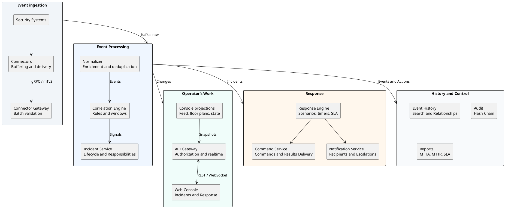

# Open-Source PSIM Platform

<!-- language-links -->
[English](README.md) | [Русский](docs/ru/repository/README.md)
<!-- /language-links -->

An open-source vendor-neutral platform for managing physical security situations (PSIM, Physical Security Information Management). It integrates events from security and fire protection systems, SCADA, video analytics, and engineering infrastructure into a unified process: incident detection, response, closure, and reporting.

The platform is designed for security services, incident centers, and integrators. It can be deployed independently on local or cloud infrastructure. The server side is written in C++, while the web console is built with React and TypeScript. License: [MIT](LICENSE).

[Quick Start](#quick-start) · [Documentation](docs/README.md) · [Architecture](docs/architecture/README.md) · [Release Status](docs/product/release-readiness.md) · [Participation](CONTRIBUTING.md)

## Features

- **Device integration.** gRPC protocol for connectors, C++ SDK, disk buffering, and event delivery. The repository includes a simulator and standard Webhook/HTTP connectors.
- **Event processing.** Normalization, enrichment, deduplication, history, and search. Correlation based on conditions, time windows, sequences, and absence of events.
- **Incident handling.** Unified feed, floor plans, device status, assignment of responsible parties, confirmed transfer of responsibility, and updates via WebSocket.
- **Response management.** Scenarios, checklists, commands to devices, SLA control, escalation, and notifications.
- **Audit and reporting.** History of actions with hash chain and integrity checks, export, MTTA/MTTR metrics, and SLA compliance.
- **Administration and operation.** Object and device catalog, role-based access, maintenance, diagnosis, certificate management, backup, and restoration.
- **Assistants and exercises.** Summaries from authorized sources, connection to local model provider, and isolated training scenarios.

Details: [Product description](docs/product/product-brief.md), [Roles and working scenarios](docs/product/roles-and-journeys.md), [MVP boundaries](docs/product/mvp-scope.md).

## Project Status

The project is in MVP development stage. Basic server services, operator console, administration, audit, and reporting interfaces are implemented. A local test environment is available: events from the connector are processed and displayed as incidents in the browser.

Full cross-verification and operational testing remain to be completed. Specifically, upgrades and rollback under 50,000 events per second have not been confirmed, nor has full restoration of both topologies with independent target storage and RPO/RTO measurement. Implemented functions and unconfirmed conditions are listed in [Release Status](docs/product/release-readiness.md); ongoing criteria are in [Quality Registry](docs/quality/requirements.yaml) and [Acceptance Specifications](docs/product/acceptance-spec.md).

## Quick Start

The local test environment allows testing the path from the simulator to the operator feed without connecting to real devices.

### Requirements

Development, build, and testing are performed on Linux with native Docker Engine and Docker Compose. The host requires:

- Git.
- [Docker Engine and Docker Compose](https://docs.docker.com/engine/install/debian/).
- Python 3 with PyYAML, available for `python3 -I`.
- [Task 3.x](https://taskfile.dev/docs/installation).

Environment check:

```bash
docker info
docker compose version
task --version
python3 -I -c "import yaml; print(yaml.__version__)"
```

### Starting the test environment

```bash
git clone https://github.com/d8zerg/psim.git
cd psim
task flow:up
task flow:emit COUNT=3
```

`task flow:up` builds the required components and runs infrastructure and application processes. `task flow:emit` sends synthetic alarms through mTLS connector.

Open [http://localhost:4173](http://localhost:4173), click **Sign in** and log in with the development account:

| Field | Value |
|---|---|
| Login | `operator1` |
| Password | `psim-dev-Passw0rd` |

In the operator feed, incidents formed from sent events will appear. Service addresses and local environment credentials are provided by `task env:endpoints`.

### Stopping the test environment

```bash
task flow:down
task env:down
```

The first command stops application processes, the second stops infrastructure with data preserved. The composition of the test environment, test configuration, and cross-verification are described in [End-to-end event flow guide](docs/engineering/event-flow.md).

## Architecture and Stack

Main flows: event reception, incident formation, operator operation, and response scenario execution.



The diagram shows logical steps and main data consumers. Inter-service events are sent via Apache Kafka; brokers, individual topologies, and storage are omitted. History, audit, and reporting are updated as processing progresses, including operator actions and response results.

The operator uses API Gateway to assign and acknowledge incidents, execute scenario steps and close incidents after completing required actions. The gateway receives snapshots from the projection service, and real-time changes are read from Kafka and sent to the console via WebSocket. Commands are delivered to devices through Connector Gateway and connector; results are returned to the command service and response scenario.

Services are divided by domain contexts; the domain core is separated from infrastructure adapters.

| Domain | Technologies |
|---|---|
| Server and SDK | C++23, Boost.Asio and Beast, gRPC, Protobuf |
| Event flows | Apache Kafka in KRaft mode, Schema Registry |
| Data storage | PostgreSQL, ClickHouse, RocksDB, Valkey, S3-compatible SeaweedFS |
| Identity and access | Keycloak, OIDC, RBAC, access scopes, mTLS |
| Web client | React, TypeScript, Vite, TanStack, Zustand, Tailwind CSS |
| Observability | OpenTelemetry, Prometheus, Grafana, Loki, Tempo |
| Build and dependencies | Clang, CMake, Ninja, Conan 2, Task, Docker |

Component diagrams, data flows, and delivery semantics are described in [Architecture Documentation](docs/architecture/README.md). Public interfaces are in [Contracts](contracts/README.md), and architecture decisions are in [ADR Registry](docs/adr/README.md).

## Deployment and Operation

Target OS: Debian 13 x86_64. Single-machine and cluster topologies on virtual machines are supported, along with DEB packages and container images without root access. The technical name of the test environment, images, and deliveries is `psim-platform`.

For administrative operations, C++ CLI `psimctl` is used, while for collecting node and infrastructure metrics, `psim-monitoring-agent` is used. Operations include installation and updates, diagnosis, certificate management, encrypted backups in external S3, and restoration.

Instructions and restrictions for verified configurations:

- [Topologies and deployment requirements](docs/engineering/deployment-topologies.md).
- [Installation, updates, and rollbacks](docs/engineering/installation-and-upgrades.md).
- [Administration, backup, and restoration](docs/engineering/administration-and-recovery.md).
- [Monitoring, logs, traces, and notifications](docs/engineering/observability.md).

## Development

Use the environment from [Quick Start](#requirements). The compiler, C++ dependencies, and web development tools are run in containers with fixed versions. The [dev container](.devcontainer/devcontainer.json) is available, connected to the Docker Engine on the Linux host.

Services, connectors, `psimctl`, and product logic are implemented in C++. Python is used for auxiliary tasks such as building, generation, deployment, and testing. Details are in [Language selection rules](docs/engineering/product-runtime-languages.md).

| Command | Purpose |
|---|---|
| `task cpp:test` | C++ build and testing |
| `task web:check` | Web client verification and build |
| `task ci` | Local pipeline for affected components |
| `task ci FULL=true` | Full local pipeline |
| `task docs:check` | Documentation verification and portal build |
| `task web:dev` | Design system dashboard on `http://localhost:5173/design-system.html` |
| `task web:catalogue` | Component catalog on `http://localhost:61000` |
| `task docs:portal` | Documentation portal build in `build/portal/site/` |
| `task docs:serve` | View of the built portal on `http://localhost:8000` |

The design system dashboard uses demonstration data. The web client and its commands are described in [web/README.md](web/README.md).

For C++, presets `debug`, `release`, `relwithdebinfo`, `asan`, `tsan`, and `coverage` are available. For example, `task cpp:build PRESET=release JOBS=4` runs a release build with four parallel tasks. Artifacts are located in `build/debian13/<preset>/`, and cache is in `.cache/`.

The full list of commands is `task --list-all`. The workflow and checks are described in [CONTRIBUTING.md](CONTRIBUTING.md), and local infrastructure management is described in [deploy/README.md](deploy/README.md).

## Repository Structure

| Directory | Purpose |
|---|---|
| `contracts/` | Protobuf, OpenAPI, AsyncAPI, topic registries, taxonomies, and errors |
| `libs/platform/` | Runtime, asynchronous primitives, and infrastructure libraries |
| `libs/domain/` | Domain event models, correlations, incidents, and responses |
| `services/` | Services for domain contexts |
| `connectors/` | SDK, simulator, and integration with external systems |
| `web/` | Web console, design system, REST and realtime clients |
| `deploy/` | Local environment, images, and deployment profiles |
| `tests/` | System, end-to-end, load and chaos tests |
| `tools/` | `psimctl`, monitoring agents, migrators, build tools, generators, and checks |
| `docs/` | Product, architecture, ADR, engineering guides, security, and quality |

C++ module and component tests are located near the code. The repository, code, and namespace use the name `psim`.

## Participation, Security, and License

Suggestions and errors are accepted through [GitHub Issues](https://github.com/d8zerg/psim/issues), and changes are made through pull requests. Participation procedures are described in [CONTRIBUTING.md](CONTRIBUTING.md).

For security issues, report via [SECURITY.md](SECURITY.md).

The code is distributed under the [MIT](LICENSE) license.
