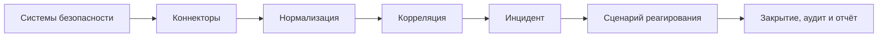

# Open-Source PSIM Platform

Открытая вендор-нейтральная платформа управления ситуациями в физической безопасности (PSIM). Проект предназначен для объединения событий охранных и пожарных систем, СКУД, видеоаналитики, периметра и инженерной инфраструктуры в единый процесс: от обнаружения ситуации до реагирования, закрытия инцидента и отчёта.

Код распространяется под [лицензией MIT](LICENSE). Платформа рассчитана на самостоятельное развёртывание в локальной или облачной инфраструктуре.

**Статус: разработка MVP, фаза Ф8, веб-приложение.** Фазы Ф0-Ф7 и шаг 8.1, дизайн-система и UX-основа, утверждены. Далее - серверная поддержка новых интерфейсных операций и рабочие экраны консоли.

[Документация](docs/README.md) · [прогресс](docs/progress.md) · [план MVP](docs/psim-mvp-development-plan.md) · [архитектура](docs/architecture/README.md) · [контракты](contracts/README.md)

## Назначение

Open-Source PSIM Platform предназначена для служб безопасности организаций, ситуационных и мониторинговых центров, а также интеграторов, подключающих оборудование разных производителей.

- **Оператору** - общая лента инцидентов, состояние устройств на планах объектов, инструкции реагирования и контроль исполнения.
- **Старшему смены** - назначение ответственных, передача инцидентов, контроль SLA и эскалаций.
- **Интегратору** - открытый протокол коннекторов, SDK и тестовый набор соответствия.
- **Администратору и эксплуатации** - настройка объектов и правил, наблюдаемость, обслуживание, обновление и восстановление.
- **Аудитору и руководителю** - история действий, проверка целостности журнала и отчёты.

Роли и рабочие сценарии описаны в [roles-and-journeys.md](docs/product/roles-and-journeys.md), цели продукта - в [product brief](docs/product/product-brief.md).

## Текущее состояние

| Область | Статус |
|---|---|
| Архитектура, контракты, инженерная платформа и инфраструктурные библиотеки | Ф0-Ф2 утверждены |
| [Сквозной стенд M1](docs/engineering/event-flow.md): событие -> инцидент -> браузер | Ф3 утверждена |
| [SDK и коннекторы](docs/engineering/connector-sdk.md), [каталог ресурсов](docs/engineering/resource-catalog.md), [нормализация и история](docs/engineering/normalization-and-history.md) | Ф4 утверждена |
| [Правила](docs/engineering/correlation-rules.md), [рабочая корреляция](docs/engineering/live-correlation.md), [инциденты](docs/engineering/incident-service.md) и [поиск истории](docs/engineering/event-history.md) | Ф5 утверждена |
| [Сценарии реагирования](docs/engineering/response-engine.md), [команды](docs/engineering/command-service.md), [SLA и уведомления](docs/engineering/notifications.md), [аудит](docs/engineering/audit-service.md) и [отчёты](docs/engineering/incident-reports.md) | Ф6 утверждена |
| [API Gateway](docs/engineering/api-gateway.md), [проекции консоли](docs/engineering/console-projections.md), [realtime](docs/engineering/realtime.md) и [авторизация](docs/security/authorization.md) | Ф7 утверждена |
| [Дизайн-система и UX-основа](docs/engineering/design-system.md) | Шаг 8.1 утверждён |
| Серверная поддержка новых UI-операций, оболочка, операторские и административные экраны | Шаги 8.1a-8.6 не начаты |
| Поставка и эксплуатация, сквозная верификация, демонстрация и документация выпуска | Ф9-Ф11 не начаты |

На реальном стенде работает вход OIDC с PKCE и минимальная лента инцидентов со снимком и WebSocket-обновлениями. Отдельная витрина дизайн-системы содержит компоненты и детерминированные макеты: темы, плотность, ru/en, планы объектов, тревоги, подтверждения и восстановление после разрыва связи. Обновления сохраняют строки, фокус и положение прокрутки. Витрина использует демонстрационные данные; её оперативные сценарии и ассистент пока не подключены к серверным операциям.

Подробные результаты и ограничения - в [прогрессе разработки](docs/progress.md) и [приёмке дизайн-системы](docs/engineering/design-system-acceptance.md).

## Возможности целевого MVP

| Область | Состав |
|---|---|
| Интеграции | Коннекторы по gRPC, SDK для C++, буферизация на диске и досылка, симулятор и эталонный Webhook/HTTP-коннектор |
| Объекты и оборудование | Площадки, здания, этажи, зоны, массовый импорт устройств, поэтажные планы и их версии |
| Обработка событий | Таксономия, нормализация, обогащение, дедупликация, история и поиск; корреляция по условиям, окнам, последовательностям и отсутствию событий |
| Инциденты и реагирование | Жизненный цикл инцидента, назначение, подтверждённая передача ответственности, сценарии, чек-листы, команды на устройства, SLA, эскалации и уведомления |
| Операторская консоль | Лента и планы объектов, realtime, качество и свежесть состояния устройств, горячие клавиши, звуковое оповещение, текущий дежурный |
| Аудит и отчёты | Журнал с цепочкой хэшей, проверка целостности, экспорт, MTTA, MTTR, ложные тревоги и соблюдение SLA |
| Эксплуатация | Разовое обслуживание устройств и зон, сертификаты и доверие, резервное копирование, восстановление, диагностический replay с изоляцией от рабочих действий |

Подробный состав и исключения - в [границах MVP](docs/product/mvp-scope.md), проверяемые критерии - в [сценариях приёмки S1-S13](docs/product/acceptance-spec.md). Правила свежести данных, обслуживания, передачи ответственности, хранения файлов и replay закреплены в [эксплуатационных моделях](docs/architecture/operational-capabilities.md) и [ADR-042](docs/adr/0042-operational-capabilities.md).

Проектные цели MVP: устойчивая обработка **50 000 событий/с** на эталонном кластере, задержка **p99 событие -> инцидент в консоли ≤ 1 с**, отсутствие потерь событий и дубликатов инцидентов в приёмочных сценариях. Эти цели подтверждаются на этапе сквозной верификации; методы и стенды определены в [стратегии качества](docs/quality/strategy.md) и [матрице верификации](docs/quality/verification-matrix.md).

После MVP предусмотрены отдельные направления: Kubernetes, ГИС/BIM, встроенное видео и видеостена, мобильное реагирование, edge, федерация центров и мультитенантная эксплуатация. Собственные медиа-вложения и полные календарные графики смен также находятся за пределами MVP. Границы ассистента с источниками определены отдельно в [ADR-067](docs/adr/0067-assistant-boundaries.md); текущая витрина использует детерминированные ответы.

## Архитектура и стек

Основной процесс обработки:



Apache Kafka служит центральной шиной событий во всех топологиях. Сервисы разделены по доменным контекстам; доменное ядро отделено от инфраструктурных адаптеров. Подтверждения, повторы и дедупликация определяются для каждого потока в [модели доставки](docs/architecture/data-flows.md).

| Слой | Технологии |
|---|---|
| Сервер | C++23, Boost.Asio и Beast, gRPC, Protobuf |
| Событийные потоки | Apache Kafka в режиме KRaft, Schema Registry |
| Транзакционные данные | PostgreSQL 18.x, inbox/outbox |
| Кэши и сессии | Valkey, Redis-совместимый протокол |
| История и аналитика | ClickHouse |
| Состояние корреляции | RocksDB с журналом изменений в Kafka |
| Идентификация и доступ | Keycloak, OIDC, RBAC и области доступа; mTLS для коннекторов |
| Файлы | Порт FileStore, AWS SDK и S3-совместимый SeaweedFS; загрузка и версии планов в Resource Catalog |
| Веб-клиент | React 19, TypeScript, Vite, TanStack Query/Router/Table/Virtual, Zustand, Tailwind CSS 4 |
| Дизайн-система | Семантические токены DTCG, Radix UI, локальные IBM Plex Sans/Mono, Lucide, ru/en; каталог Ladle |
| Наблюдаемость | OpenTelemetry, Prometheus, Grafana; в локальном окружении - Loki и Tempo |
| Сборка и проверка | Clang 21, системная libstdc++, CMake, Ninja, Conan 2, Task, санитайзеры и автоматизированные тесты |

Схемы компонентов, сценарии выполнения и решения с альтернативами - в [архитектуре](docs/architecture/README.md) и [реестре ADR](docs/adr/README.md).

## Поддерживаемая платформа

**Единственная официально поддерживаемая ОС MVP - Debian 13 x86_64.** Сборка и проверка артефактов выполняются на этой платформе.

Целевая поставка MVP включает DEB-пакеты и контейнерные образы без root. Топологии - одна машина и кластер на VM. Установщик, systemd-юниты, обновление и восстановление относятся к фазе Ф9; схема поставки описана в [deployment.md](docs/architecture/deployment.md).

Правила совместимости API и коннекторов, обновления и поддержки выпусков - в [политике проекта](docs/engineering/compatibility-and-support.md).

## Разработка

Вся разработка, сборка, тестирование и локальные конвейеры выполняются с нативным Docker Engine на Linux. Docker daemon работает непосредственно на хосте разработчика. Все команды выполняются через [Task](https://taskfile.dev) из корня репозитория. Компилятор, зависимости C++ и инструменты веб-разработки запускаются в контейнерах с закреплёнными версиями.

### Предварительные требования

- Git.
- Linux-хост с нативным Docker Engine, плагином Docker Compose и доступом к локальному Docker daemon у текущего пользователя. Установка для Debian - в [документации Docker](https://docs.docker.com/engine/install/debian/).
- Python 3 с PyYAML, доступным для `python3 -I`.
- Task 3.x: [инструкция установки](https://taskfile.dev/docs/installation).

Проверка инструментов:

```bash
docker info
docker compose version
task --version
python3 -I -c "import yaml; print(yaml.__version__)"
```

На хосте достаточно этих инструментов: C++ toolchain собирается автоматически, Node и pnpm запускаются в контейнере. Первый запуск загружает образы и зависимости; последующие используют кэш в `.cache/`.

### Получение кода

```bash
git clone https://github.com/d8zerg/psim.git
cd psim
task                         # доступные задачи
```

### Дизайн-система и макеты

После подготовки окружения компоненты и макеты можно открыть без запуска серверов платформы.

```bash
task web:dev                 # сервер разработки: http://localhost:5173
```

Откройте `http://localhost:5173/design-system.html`. Кнопка запуска оперативной симуляции включает демонстрационные тревоги, разрывы связи, передачу смены и подтверждения команд. Каталог компонентов запускается отдельно: `task web:catalogue`, адрес `http://localhost:61000`.

Устройство пакетов и команды - в [web/README.md](web/README.md), принципы и компоненты - в [руководстве по дизайн-системе](docs/engineering/design-system.md).

### Сквозной стенд с реальными сервисами

```bash
task flow:up                 # инфраструктура, сборка и прикладные процессы
task flow:emit COUNT=3        # отправить синтетические тревоги через mTLS-коннектор
```

Откройте `http://localhost:4173`, нажмите Sign in и войдите как `operator1` с паролем `psim-dev-Passw0rd`. События проходят через Connector Gateway, Normalizer, Correlation Engine, Incident Service, Projection Service и API Gateway в браузерную ленту.

```bash
task flow:down               # остановить прикладные процессы с сохранением данных
task env:down                # остановить инфраструктуру с сохранением данных
```

Команды запуска, состав потока и методика сквозной проверки - в [руководстве M1](docs/engineering/event-flow.md). Учётные данные и тестовая PKI этого стенда предназначены для разработки.

### Сборка C++

```bash
task contracts:check         # проверка публичных контрактов
task cpp:test                # зависимости, сборка и тесты C++
```

По умолчанию используется пресет `debug`. Доступны `release`, `relwithdebinfo`, `asan`, `tsan`, `coverage`; пример: `task cpp:build PRESET=release JOBS=4`.

Результаты находятся в `build/debian13/<preset>/`, кэш Conan и ccache - в `.cache/debian13/`. Для VS Code подготовлен [dev container](.devcontainer/devcontainer.json) на том же toolchain. Команды, которым нужен Docker, запускаются из терминала хоста.

### Инфраструктурный стенд

```bash
task env:up                  # Kafka, Registry, PostgreSQL, ClickHouse, Valkey, Keycloak, наблюдаемость
task env:test                # смоук-тесты окружения
task env:endpoints           # адреса и учётные данные разработки
task test:security           # JWT/JWKS, mTLS, секреты, продление и отзыв
task test:component          # компонентные тесты адаптеров против запущенного окружения
task env:down                # остановка с сохранением данных
```

По умолчанию запускается один брокер Kafka; для чистого стенда с тремя брокерами - `task env:up KAFKA=3`. Порты интерактивного окружения публикуются на `127.0.0.1`. Учётные данные `psim-dev-*` предназначены для разработки. Управление контейнерами, смена топологии и удаление данных описаны в [руководстве по окружению](deploy/README.md#локальное-окружение).

### Портал документации

```bash
task docs:portal             # собрать портал в build/portal/site
task docs:serve              # портал: http://localhost:8000
```

Портал включает продуктовые и инженерные документы, архитектуру, ADR, диаграммы и справочники REST, Kafka и Protobuf. Навигация по исходным документам - в [docs/README.md](docs/README.md).

## Проверки и рабочий процесс

Перед каждым коммитом выполняется `task ci`. Конвейер определяет область изменения; `task ci FULL=true` запускает все его этапы. Порядок проверки закреплён в [ADR-034](docs/adr/0034-local-ci-and-supply-chain.md) и [ADR-036](docs/adr/0036-no-git-hooks.md).

| Команда | Назначение |
|---|---|
| `task check` | Проверки контрактов, архитектуры, C++, веб-клиента и документации |
| `task gen` | Обновить генерируемые контракты и реестры документации |
| `task cpp:format` / `task cpp:lint` | Формат C++ и clang-tidy |
| `task cpp:test:sanitizers` / `task cpp:coverage` | ASan+UBSan, TSan и контроль покрытия |
| `task cpp:runtime-test` | Запуск артефактов на Debian 13 x86_64 без toolchain |
| `task web:check` | Формат, генерация, линтеры, типы, тесты с покрытием, сборка, бюджеты, визуальная регрессия и доступность |
| `task web:stability` / `task web:benchmark` | Сохранение строк и фокуса при обновлении; отдельный замер больших коллекций |
| `task flow:test` | Сквозная браузерная проверка, повторы, переподключение, перезапуск API и трассировка; требует `task env:up` |
| `task sim:test` / `task sim:short` / `task sim:long` | Ручные проверки стенда и 200/10 000 прогонов; в CI не входят |
| `task sim:replay SEED=42` | Воспроизведение одного зерна с полной трассой |
| `task arch:check` | Границы модулей, чистота доменного ядра и правила SQL |
| `task bench:compare` | Сравнение производительности с базовой линией |
| `task security:deps` | Уязвимости и лицензии зависимостей, SBOM |
| `task docs:check` | Ссылки, оформление, диаграммы, модели, реестры и сборка портала |
| `task ci:run` | Дополнительный прогон закоммиченного содержимого в чистом клоне |
| `task ci:nightly` | CI, воспроизводимость сборки и сканирование образов |
| `task release` | Проверки и сборка подписанного каталога выпуска в `dist/` |

Полный список - `task --list-all`. Новый сервис создаётся задачей `task service:new`; параметры и получаемый каркас описаны в [services/README.md](services/README.md).

## Структура репозитория

| Каталог | Назначение |
|---|---|
| `contracts/` | Protobuf, OpenAPI, AsyncAPI, реестры топиков, таксономии и ошибок |
| `libs/platform/` | Runtime, асинхронные примитивы и инфраструктурные библиотеки |
| `libs/domain/` | Доменные модели и правила; реализация по фазам MVP |
| `services/` | Сервисы по доменным контекстам |
| `connectors/` | SDK, симулятор и интеграции с внешними системами |
| `web/` | Веб-консоль, дизайн-система, REST- и realtime-клиенты |
| `deploy/` | Локальное окружение и контейнерные образы; дальнейшие артефакты развёртывания |
| `tests/` | Системные, сквозные, нагрузочные и хаос-тесты |
| `tools/` | Task-задачи, toolchain, генераторы, проверки и инструменты выпуска |
| `docs/` | План, прогресс, продукт, доменная модель, архитектура, ADR, безопасность и качество |

Модульные и компонентные тесты C++ находятся рядом с кодом. Публичные клиенты и справочники генерируются из контрактов; правила их изменения - в [contracts/README.md](contracts/README.md).

Репозиторий, код и пространства имён используют `psim`. Техническое название стенда и поставки - `psim-platform`: Compose-проект `psim-platform`, образы `psim-platform/<компонент>:<тег>`, каталог выпуска `dist/psim-platform-<версия>-<коммит>/`. Пакеты компонентов сохраняют префикс `psim-`, пакеты SDK - `@psim/`.

## Участие, безопасность и лицензия

Предложения и ошибки принимаются через [GitHub Issues](https://github.com/d8zerg/psim/issues), изменения - через pull request. Подготовка окружения, правила изменений и проверок описаны в [CONTRIBUTING.md](CONTRIBUTING.md).

Порядок конфиденциального сообщения о проблеме безопасности - в [SECURITY.md](SECURITY.md). Защитные меры и их проверка определяются [моделью угроз](docs/security/threat-model.md) и [реестром требований](docs/security/threat-register.md).

Лицензия кода проекта - [MIT](LICENSE). Сведения о сторонних компонентах и их лицензиях входят в SBOM выпуска.
