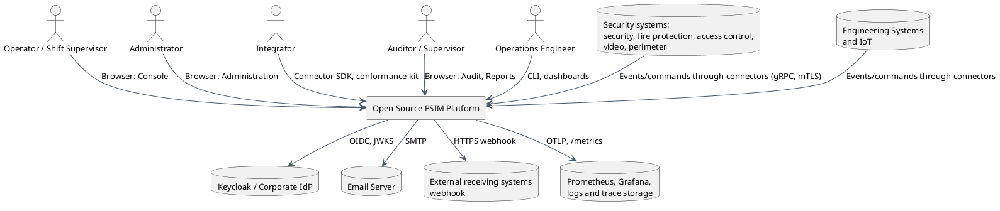
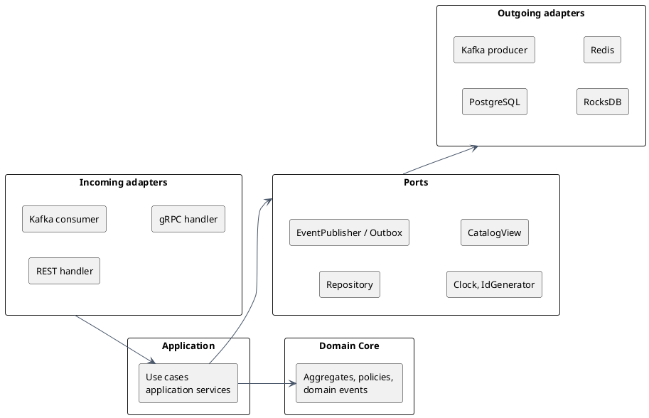

# Architecture of the Open-Source PSIM Platform (arc42)

<!-- language-links -->
[English](README.md) | [Русский](../ru/architecture/README.md)
<!-- /language-links -->

The document is structured according to the arc42 template. Major sections are organized into separate files:

| arc42 Section | Location |
|---|---|
| 1. Introduction and Goals | This document |
| 2. Constraints | This document |
| 3. Context and Boundaries | This document, C4 L1 |
| 4. Solution Strategy | This document |
| 5. Building Block View | This document, C4 L2-L3 |
| 6. Runtime View | [runtime-view.md](runtime-view.md) |
| 7. Deployment View | [deployment.md](deployment.md) |
| 8. Cross-cutting Concepts | [crosscutting.md](crosscutting.md) |
| - Data Flows and Delivery Semantics | [data-flows.md](data-flows.md) |
| - Scaling and Partitioning | [scaling.md](scaling.md) |
| 9. Architecture Decisions | [ADR Registry](../adr/README.md) |
| 10. Quality Requirements and Latency Budget | [quality.md](quality.md) |
| 11. Risks and Technical Debt | This document |
| 12. Glossary | [glossary.md](../domain/glossary.md) |

The C4 model is represented as: [c4/L2-Containers.puml](c4/L2-Containers.puml) (PlantUML). The diagrams in this document illustrate the context, flows, and boundaries of components. `task docs:plantuml` can verify all UML/C4 diagrams; the portal contains ready-made SVG files.

---

## 1. Introduction and Goals

### 1.1 Purpose

The platform implements a end-to-end cycle: an event from any source -> normalization -> correlation -> incident -> response scenario -> commands to devices -> closure -> auditing and reporting. Details can be found in [product brief](../product/product-brief.md) and [MVP scope](../product/mvp-scope.md).

The MVP operational additions have been accepted: [models, function placement, and invariants](operational-capabilities.md), [ADR-042](../adr/0042-operational-capabilities.md).

### 1.2 Quality Goals

Five main goals in order of priority. In case of conflict, the goal with the lower number wins.

| No. | Goal | Measure | Quality Scenarios |
|---|---|---|---|
| QG1 | **Correct Delivery** | 0 lost events and incidents, 0 duplicates of incidents within the qualified failure model | QS-A1..A4 |
| QG2 | **Timeliness** | Event -> incident in the console, p99 ≤ 1 second with 50,000 events per second | QS-P1..P4 |
| QG3 | **Availability** | RTO ≤ 60 seconds, RPO = 0 in the cluster; updates without downtime | QS-A5, QS-O1 |
| QG4 | **Modularity** | New sources and new response logic without changing the domain core | QS-M1..M3 |
| QG5 | **Security** | Authentication for each entry, minimal privileges, immutable auditing | QS-S1..S3 |

These are qualification targets; current evidence and outstanding conditions are listed in [release readiness](../product/release-readiness.md). Quality scenarios are detailed in [quality.md](quality.md).

### 1.3 Stakeholders

| Stakeholder | Expectations from the Architecture |
|---|---|
| Product Owner | Predictable MVP size, scaling from one machine to a cluster with one distribution |
| Lead Engineer and AI Agent | Modules with clear boundaries, which can be developed and tested independently; reproducible environment |
| Integrator | Stable documented connection protocols and SDKs |
| Client Operations | Clear topologies, observability, runbooks, updates without downtime |
| Client Security Service | Access control, encryption, auditing, threat model |

---

## 2. Constraints

### 2.1 Technical

| Constraint | Source |
|---|---|
| C++23 server: Boost.Asio and Beast, librdkafka, libpq, OpenSSL 3, gRPC and Protobuf | Technical constraints of the platform |
| Apache Kafka (KRaft) - central bus in all topologies | Technical constraints of the platform |
| PostgreSQL 18.x (libpq 18.x), Redis-compatible storage | Technical constraints of the platform; Redis implementation chosen as ADR-015 |
| ClickHouse for event history and analytics | Accepted; ADR-028 |
| Keycloak as Identity Provider (OIDC) | Technical constraints of the platform |
| Web client: React 19, TypeScript, Vite | Technical constraints of the platform |
| Debian 13 x86_64 - only officially supported OS | Accepted; ADR-032 |
| Only components with open licenses allowed to be included in commercial products | Supplied to clients; checked in CI |
| Kubernetes outside MVP | ADR-023 |

### 2.2 Organizational

- One engineer and AI agent: the architecture must allow for developing services one at a time, with independent testing; shared code is stored in platform libraries.
- Single repository, documentation as code, ADR for each significant decision.

### 2.3 Conventions

- Naming of topics: `psim.<domain>.<entity>.v<N>`.
- REST: OpenAPI 3.1, errors according to RFC 9457, cursor-based pagination.
- Time - UTC, microseconds; identifiers - UUIDv7 or named UUID ([aggregates.md](../domain/aggregates.md#01-identifiers)).
- Code and contracts use English. Documentation and the interface support English and Russian, with English as the default documentation language.

---

## 3. Context and Boundaries (C4 L1)

| External Participant | Interface | Direction |
|---|---|---|
| Connectors of external systems | gRPC over TLS 1.3 with mTLS; connector protocol v1 | Two-way flow: events -> platform, commands -> connectors |
| User Browser | HTTPS: REST v1, WebSocket realtime; static web assets | Two-way |
| Keycloak | OIDC Authorization Code + PKCE for users; client credentials for services; JWKS for token verification | Platform -> Keycloak |
| Email Server | SMTP with STARTTLS | Platform -> SMTP |
| Webhook Receivers | HTTPS POST with HMAC signature | Platform -> receiver |
| Observability | OTLP (gRPC) for tracing, logs, and metrics; HTTP `/metrics` for Prometheus | Platform -> observability stack |

The observability stack is provided with the platform, but the client can route OTLP to their own system.

---

## 4. Solution Strategy

| Task | Approach | Why |
|---|---|---|
| 50,000 events per second and growth to millions | Stream processing pipeline on Kafka with key-based partitioning; each stage is a scalable group of consumers | Horizontal scaling without redesign; order within the key |
| 0 losses and duplicates | Confirmation to the connector after `acks=all`; deterministic identifiers; exactly-once transactions in Kafka for correlation; transactional outbox and inbox at the PostgreSQL boundaries | Correctness at each step, not “on average”; verified through simulation |
| Delay ≤ 1 second | Delay budget per stage; hot path without synchronous inter-service calls; local catalog replicas; realtime channel reads changes from Kafka directly | Each stage is measurable and has a threshold |
| Correlation with C++ state without a ready-made framework | Own engine: state in RocksDB with changelog entries, partitions as units of parallelism, event time and watermarks | Analogous to Kafka Streams model, adapted for C++; risk is evaluated through end-to-end integration and load tests |
| Modularity | vendor-neutral connector protocol; declarative rules for mapping, correlation, and scenarios; hexagonal architecture | New sources and responses - configuration, not domain core code |
| Reproducibility | Kafka as a truth log; read models are rebuilt through replay; rules are tested on history | Historical rule analysis and verification |
| Testability | Deterministic domain core: time, randomness, and input/output by ports; simulation environment | Distributed behavior errors are reproduced by seeds |
| One distribution for all scales | Same images and binaries; topologies vary depending on configuration and number of instances | No separate “light” version |
| Operation | Observability from the first step: OTLP tracing through Kafka headers, service metrics, business metrics | Failures are visible and have runbooks |

---

## 5. Building Blocks

### 5.1 Level 2: Containers

```plantuml
@startuml
skinparam backgroundColor white
skinparam defaultFontName SansSerif
skinparam defaultFontSize 13
skinparam shadowing false
skinparam roundcorner 6
skinparam ArrowColor #475569
skinparam packageStyle rectangle
skinparam nodesep 35
skinparam ranksep 45

left to right direction
rectangle "Connectors\nConnector SDK" as CONN
rectangle "Connector Gateway" as CGW
queue "psim.ingest.raw.v1" as K1
rectangle "Normalizer" as NORM
queue "psim.catalog.v1" as CATK
queue "psim.events.normalized.v1" as K2
rectangle "Event History" as EH
rectangle "Correlation Engine" as CE
queue "psim.config.v1" as CFG
queue "psim.signals.v1" as K3
rectangle "Incident Service" as INC
queue "psim.incidents.events.v1" as K4
rectangle "Response Engine" as RE
queue "psim.response.events.v1" as K5
rectangle "Command Service" as CMD
queue "psim.commands.v1" as K6
queue "psim.commands.results.v1" as K7
rectangle "Notification Service" as NOTIF
rectangle "Projection Service" as PROJ
rectangle "API Gateway:\nREST + realtime" as RT
rectangle "Web Application" as WEB
rectangle "Resource Catalog" as CAT
database "Floor plans: S3-compatible storage" as FILES
rectangle "Rule Management\nin Correlation Engine API" as RULES
rectangle "all services" as ALL
queue "psim.audit.v1" as AUDK
rectangle "Audit Service" as AUDS
CONN --> CGW : gRPC mTLS
CGW --> K1 : raw
K1 --> NORM
CATK --> NORM
NORM --> K2 : normalized
K2 --> EH
K2 --> CE
CFG --> CE
CE --> K3 : signals
K3 --> INC
INC --> K4 : outbox
K4 --> RE
RE --> K5 : outbox
K5 --> INC
RE --> CMD
CMD --> K6 : outbox
K6 --> CGW
CGW --> K7
K7 --> CMD
K5 --> NOTIF
NOTIF --> K5 : outbox
K4 --> PROJ
K5 --> PROJ
K4 --> RT
K5 --> RT
PROJ --> RT
RT --> WEB : HTTPS / WSS
CAT --> CATK
CAT --> FILES : FileStore
RULES --> CFG
ALL ..> AUDK
AUDK ..> AUDS
@enduml
```

| Container | Technology | Responsibility | Storage | Scaling |
|---|---|---|---|---|
| Connector Gateway | C++, gRPC | Connector sessions, mTLS, validation, credits, writing to Kafka, command delivery | Redis: session registry | No state; N instances per L4 balancer |
| Resource Catalog | C++, REST | Locations, devices, sources, connectors, import, floor plan versions, maintenance | PostgreSQL + FileStore (S3-compatible storage) | 1-2 instances (not on hot path) |
| Normalizer | C++ | Mapping, enrichment, deduplication, DLQ | Local catalog replica in memory; deduplication window in memory with recovery from Kafka | Per partition `psim.ingest.raw.v1` |
| Event History | C++ | Loading all events and their links to signals to ClickHouse, searching | ClickHouse | Per partition `psim.events.normalized.v1` |
| Correlation Engine | C++ | Rules, windows, state, signals; API for rule management and testing | RocksDB + changelog; PostgreSQL for rules | Per partition `psim.events.normalized.v1` |
| Incident Service | C++, REST | Aggregating incidents, grouping, assigning, transferring responsibility, timeline | PostgreSQL + inbox + outbox | Per partition `psim.signals.v1`; user requests - any instance |
| Response Engine | C++, REST | Scenarios, executions, SLA and timers, escalation | PostgreSQL + outbox | Reading Kafka per partition; timers are serialized by locking on the PostgreSQL aggregate |
| Command Service | C++, REST | Lifecycle of commands, acknowledgments, timeouts | PostgreSQL + outbox | 2+ instances |
| Notification Service | C++, REST | In-app channels, email, webhook; contacts, receipts, retries, aggregation | PostgreSQL | 1-2 instances |
| Projection Service | C++ | Feed, state of objects and devices, operator workload; incident facts and reports | Redis (hot), PostgreSQL (requests), ClickHouse (facts and reports) | Per input partition |
| Audit Service | C++, REST | Hash chain, searching, exporting, Keycloak log | Append-only PostgreSQL and external archive of signed checkpoints | 2 instances; writing is serialized by locking on the tenant |
| API Gateway | C++, Beast | REST v1, WebSocket realtime, JWT, ABAC, limits, routing | Redis: limits | No state; N instances |
| Web Application | React, TypeScript | Operator console, administration, auditing, reports | - | Static assets served by API Gateway or web server |
| Admin CLI | C++ | Diagnosis, DLQ, rebuilding projections, auditing verification | - | - |

The quality of the Web Application is tested by the [general pipeline](../engineering/web-client-quality.md): real-service scenarios, visual regression, accessibility, session recovery, and [load measurements](../engineering/web-client-loading.md). Modules are loaded after role verification; module manifests do not replace isolation of server data. Command steps are confirmed through the Response Engine, which links server commands with execution results.

Infrastructure: Kafka (KRaft), Schema Registry (ADR-003), PostgreSQL, Redis-compatible storage, ClickHouse with ClickHouse Keeper (ADR-028), Keycloak, OpenTelemetry Collector, Prometheus, Grafana, log and trace storage.

**Rule management** is placed in the Correlation Engine as a separate REST module, not as a separate service: rules and engine are changed together, saving one service in MVP. The module works on any instance and publishes an active set in `psim.config.v1`.

**Timer service** - a platform library, not a separate service. Timers are stored in the owning service’s PostgreSQL database (Response Engine, Command Service) and are served by instances by locking the aggregate and atomic execution in the same transaction. Details - ADR-012.

### 5.2 Level 3: Components of Key Services

All services are built in a hexagonal pattern:

Rule: Domain core is a separate CMake library without dependencies on infrastructure libraries and system time; enforced by a fitness function.

#### Correlation Engine

| Component | Responsibility |
|---|---|
| Partition Worker | One per assigned partition: reading batches, processing, Kafka transaction |
| Rule Evaluator (domain) | Pure function `(state, event, rules, now) -> (state', signals)` for each type of rule |
| State Store | State port; RocksDB adapter with changes recorded in changelog in the same transaction |
| Watermark Tracker | Watermarks per partition and source; timers by event time |
| RuleSet Loader | Reads `psim.config.v1`, compiles the set, atomically switches at the offset boundary |
| Repartitioner | For rules with site keys: publishes filtered events in `psim.correlation.repartition.v1` ([scaling.md](scaling.md#3-correlation-and-keys)) |
| Rule Management API | CRUD, validation, testing, activation of the set |
| Dry-run Runner | Tests rules over historical range `psim.events.normalized.v1` in isolated state storage |

#### Incident Service

| Component | Responsibility |
|---|---|
| Signal Consumer | Batch consumption of signals; database transaction: inbox + change in aggregate + outbox; offset commit after commit |
| Incident Aggregate (domain) | Invariants I1-I10, state model |
| Grouping Policy (domain) | Choice: Join to an existing one or create a new one |
| Command API | REST commands from users with ETag and idempotency keys |
| Response Events Consumer | Updates `blocking_steps` and Response timeline events |
| Outbox Relay | Publishes outbox in `psim.incidents.events.v1` and `psim.audit.v1` |

#### Connector Gateway

| Component | Responsibility |
|---|---|
| gRPC Server | TLS termination, mTLS, bidirectional streams |
| Session Manager | Session state model, heartbeat, fencing, registration in Redis |
| Ingest Pipeline | Validation of schema and source properties, batch writing to Kafka, confirmation after `acks=all` |
| Catalog View | Local copy of connectors and sources from `psim.catalog.v1` |
| Command Dispatcher | Reading `psim.commands.v1`, delivering to the local session, recording results |

---

## 9. Architecture Decisions

The registry is described in [docs/adr](../adr/README.md). Key architectural solutions and ADRs are as follows:

| Solution | Description | ADR |
|---|---|---|
| Normalizer works with exactly-once (Kafka transactions), not at-least-once; source tracker in `psim.normalizer.state.v1` | [data-flows.md](data-flows.md#32-normalization-psimingestrawv1---psimeventsnormalizedv1) | [ADR-006](../adr/0006-delivery-semantics.md) |
| Key `psim.signals.v1` - `grouping_key`, not `correlation_key` | [data-flows.md](data-flows.md#33-correlation-psimeventsnormalizedv1---psimsignalsv1) | [ADR-007](../adr/0007-partitioning-strategy.md) |
| Redistribution for rules with keys wider than the zone through `psim.correlation.repartition.v1` | [scaling.md](scaling.md#3-correlation-and-keys) | [ADR-007](../adr/0007-partitioning-strategy.md), [ADR-009](../adr/0009-correlation-state-store.md) |
| «Escalated» - orthogonal level, «False» - resolution, not incident state | [state-models.md](../domain/state-models.md#1-incident) | [ADR-027](../adr/0027-incident-states.md) |
| The lifecycle of commands and notifications is published in `psim.response.events.v1` | [data-flows.md](data-flows.md#35-response-psimresponseeventsv1) | [ADR-006](../adr/0006-delivery-semantics.md) |
| Commands are read by all gateway instances by broadcast; fast rejection using the session registry | [data-flows.md](data-flows.md#36-commands-psimcommandsv1-and-psimcommandsresultsv1) | [ADR-018](../adr/0018-command-routing.md) |
| Realtime: Snapshot from projections with offsets + deltas directly from Kafka | [crosscutting.md](crosscutting.md#9-realtime-snapshot-and-deltas) | [ADR-019](../adr/0019-realtime-channel.md) |
| Timer service - library, timers are owned by the service owner | Section 5.1 | [ADR-012](../adr/0012-response-execution-and-timers.md) |
| Rule management - Correlation Engine module | Section 5.1 | [ADR-001](../adr/0001-monorepo-structure.md) |
| PostgreSQL HA: Patroni + etcd, synchronous replication | [deployment.md](deployment.md#3-cluster-on-vms-topology) | [ADR-023](../adr/0023-deployment-topologies.md) |
| REST DTO and JSON serialization in C++ | [crosscutting.md](crosscutting.md#14-synchronous-api-between-web-client-and-services) | [ADR-026](../adr/0026-rest-contract-and-dto.md) |
| ClickHouse for event history, signal connections, incident facts, and rule statistics | [ADR-028](../adr/0028-clickhouse-analytical-storage.md) | [ADR-028](../adr/0028-clickhouse-analytical-storage.md) |
| Deterministic `source_id` = UUIDv5(`connector_id`, `source_ref`) | [ADR-029](../adr/0029-deterministic-source-id.md) | [ADR-029](../adr/0029-deterministic-source-id.md) |
| Composite key for the `resource_type:resource_id` catalog | [data-flows.md](data-flows.md#37-catalog-psimcatalogv1) | [ADR-007](../adr/0007-partitioning-strategy.md) |

---

## 11. Risks and Technical Debt

Unverified release conditions are listed in [release readiness](../product/release-readiness.md). Architectural risks and ways to test them are as follows:

| Risk | Impact | Measure | Verification |
|---|---|---|---|
| Delay in Kafka transaction commit consumes 100 ms of budget | QS-P2 violation | Commit interval 20-50 ms, measurement in representative end-to-end load; reduce batch size if necessary | Load profile LOAD-50K and Kafka metrics |
| Recovery time for correlation state exceeds 30 seconds | RTO violation | Rule window limit (R3), compact state format; state backups as an option | State recovery and chaos scenario |
| Sequential audit on the tenant is a bottleneck | Audit delay | Audit not during active events: only actions of subjects and changes to aggregates; batch writing | Load tests for audit chain |
| Broadcast reading of commands by all gateway instances | Increase in load with many instances | Amount of commands is small; as the number increases, routing through session registry (ADR-018) | Load tests for command routing |
| Kafka storage volume during long retention | Disk cost | Compression with zstd, retention by levels, capacity model | Capacity model and long-load test |
| Maintenance of the native C++ Schema Registry client | Engineering effort | Thin native client with caching, only needed operations | Integration tests for Schema Registry |
