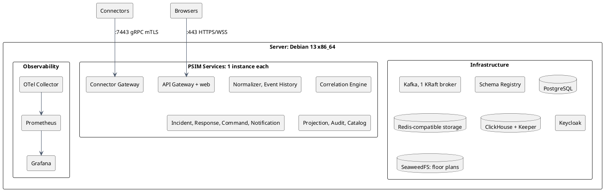
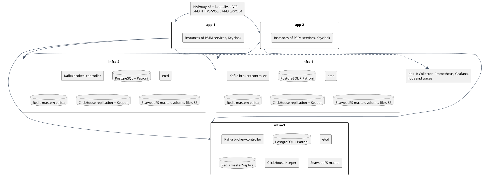

# Deployment view

<!-- language-links -->
[English](deployment.md) | [Русский](../ru/architecture/deployment.md)
<!-- /language-links -->

Section 7 arc42. MVP topologies: one machine and cluster on VMs. Kubernetes is not part of the MVP (X15), but images are ready for it: without root, configuration via files and variables, health endpoints, proper shutdown via `SIGTERM`. Solutions are ADR-023 and ADR-024; implementation is described in [topologies](../engineering/deployment-topologies.md) and [upgrade procedure](../engineering/installation-and-upgrades.md).

---

## 1. Delivery artifacts

| Artifact | Content |
|---|---|
| Container images | One image per service; minimum base; user without root; signature and SBOM |
| Packages `.deb` | Binary applications and common taxonomy package; systemd units and configuration form a profile. Infrastructure uses Docker Compose on Debian 13 x86_64 |
| Web application | Static files, distributed via API Gateway or web server |
| Installer | Precondition checks, generates configuration based on topology profile, creates database tables and schemas, loads Keycloak realm |
| Observability package | Configuration for Collector, Prometheus, Grafana dashboards, alert rules, runbook |
| Administrative CLI | `psimctl` |
| File storage | SeaweedFS with private bucket `psim-plans`; plan versions are managed by Resource Catalog, independent backup outside the working cluster ([ADR-042](../adr/0042-operational-capabilities.md), [ADR-046](../adr/0046-s3-object-storage.md)) |

Services are the same in all topologies; differences lie in configuration, number of instances, and infrastructure parameters. Initial setup includes external PKI, mTLS trust, and Keycloak according to [operational procedure](operational-capabilities.md#6-certificates-secrets-and-access-restoration).

Implemented profiles and installation commands: [deployment of both topologies](../engineering/deployment-topologies.md), [local VMs](../engineering/local-vm-lab.md), [initial PKI and accounts](../engineering/deployment-pki.md), [update and rollback](../engineering/installation-and-upgrades.md). The local cluster runs three guest OSs on a single physical host; independent failure domains are tested separately.

## 2. “One machine” topology

Launch via Docker Compose or systemd units from packages `.deb`.

**Reliability boundaries** (documented explicitly for the client):

| Property | Value |
|---|---|
| Service process failure | Restart by supervisor (Docker or systemd); no loss, RTO - restart time |
| Server failure | Downtime until the server is restored |
| Disk failure | Data loss after last backup; recommended RAID 1 or 10 and WAL archiving in PostgreSQL |
| RPO | 0 in case of process failure; interval for backup when disk fails |
| Update | With a short processing interruption: events are buffered in connector SDKs and sent after recovery |
| Performance | Goal is 10,000 events/s on the reference server ([scaling.md](scaling.md#54-standard-test-environments)) |

## 3. “Cluster on VMs” topology

| Component | Configuration | Behavior in case of one node failure |
|---|---|---|
| Kafka | 3 nodes in combined broker + controller mode (KRaft); RF 3, `min.insync.replicas` 2 | New leaders of partitions appear within seconds; writing continues |
| PostgreSQL | Patroni + etcd (3 nodes); one synchronous replica (`synchronous_mode: true`), one asynchronous; access via HAProxy based on leader role | Switching ≤ 30 seconds; committed transactions are not lost |
| Redis-compatible storage | Valkey: primary + 2 replicas on different nodes, 3 Sentinels with quorum 2 ([ADR-015](../adr/0015-redis-client-and-role.md)). Detection of primary and role checking are performed by the client; Cluster sharding in MVP is not used | Replica becomes master; caches and limits allow temporary loss, session registry is restored by reconnected connectors |
| PSIM services | ≥ 2 instances of each service, distributed across application nodes ([scaling.md](scaling.md#53-service-instances-at-50000-eventss-cluster)) | Partitions are transferred to remaining instances |
| Keycloak | 2 instances, database in PostgreSQL cluster | Already issued tokens are checked against JWKS cache; new login via remaining instance |
| HAProxy | 2 instances with shared VIP (keepalived) | VIP switching within seconds |
| ClickHouse | 1 shard × 2 replicas (ReplicatedMergeTree) on infra-1 and infra-2; ClickHouse Keeper on three infrastructure nodes ([ADR-028](../adr/0028-clickhouse-analytical-storage.md)) | Reading and writing go to the second replica; after recovery, the replica catches up; Kafka loaders deliver accumulated data |
| File storage | SeaweedFS: 3 masters (Raft), volume servers with replication on different nodes, 2 filer and 2 S3 gateways via HAProxy; metadata storage and file encryption are recorded by ADR-077 | Current plans are read in case of one node failure; unfinished replacement retains previous version |
| Observability | Separate node; does not affect processing | Loss of telemetry during failure; services are not blocked by exports |

Minimum configuration is 3 nodes with combined infrastructure and services; for 50,000 events/s, it’s 3 infrastructure nodes + 2 application nodes + one observability node.

## 4. Update

Update without downtime (S12, QS-O1) in the cluster:

1. **Pre-check.** The installer checks compatibility: Protobuf N+1 schemas are compatible with N, N+1 migrations only expand; connector protocol version is supported.
2. **Expansion migrations.** Applied before code replacement; N code continues to work on expanded schema.
3. **Schema registration.** New schema versions are registered in Schema Registry.
4. **Sequential replacement.** One instance at a time: `ready = false` -> drain -> stop -> restart N+1 with the same service instance identity -> wait for `ready` and no increase in lag -> next instance. Service order is from consumers to producers, so new consumers are ready for new fields before they appear.
5. **Shrinking migrations.** Performed in the next release (N+2), once N code has been fully retired.
6. **Rollback.** Sequential replacement back to N; possible until shrinking migrations N+1 are completed.

For Normalizer and Correlation Engine containers, additional replica startup with separate producer identity is implemented until the old one stops; Kafka assignments and readiness are checked before processing is transferred. Details and actual check boundaries are provided in [update guide](../engineering/installation-and-upgrades.md).

The S12/C-12 qualification is incomplete and optional; it is excluded from step 10.1 and does not block release. Updates without violating the SLO have not been confirmed for LOAD-50K. On a single machine, sequential replacement allows a short outage for each service.

## 5. Network Ports

| Port | Component | Access |
|---|---|---|
| 443 | API Gateway: HTTPS, WSS, web application | Users |
| 7443 | Connector Gateway: gRPC, mTLS | Connectors |
| 8443 | Keycloak | Users (login), services |
| 9092-9094 | Kafka (TLS) | Only platform services |
| 9440, 8443 | ClickHouse: native TLS protocol, HTTPS | Only platform services |
| 9234, 9281 | ClickHouse Keeper: inter-node protocol, client TLS protocol | Only ClickHouse nodes |
| 5432 | PostgreSQL (through HAProxy: 5000 - leader, 5001 - replicas) | Only platform services |
| 6379 | Redis-compatible storage (TLS) | Only platform services |
| 18333 (S3 HTTPS) | SeaweedFS S3 gateway | Only platform services |
| 9333, 8080, 8888 and gRPC ports +10000 | SeaweedFS master, volume, filer | Only SeaweedFS nodes |
| 8081 | Schema Registry | Only platform services |
| 4317 | OTel Collector (OTLP gRPC) | Only platform services |
| 9090, 3000 | Prometheus, Grafana | Operation |
| 8080 on each service | `/metrics`, `/health/*` | Prometheus, balancer |

Internal ports are closed to user networks and connectors by a network firewall; the installer generates a rules template.
