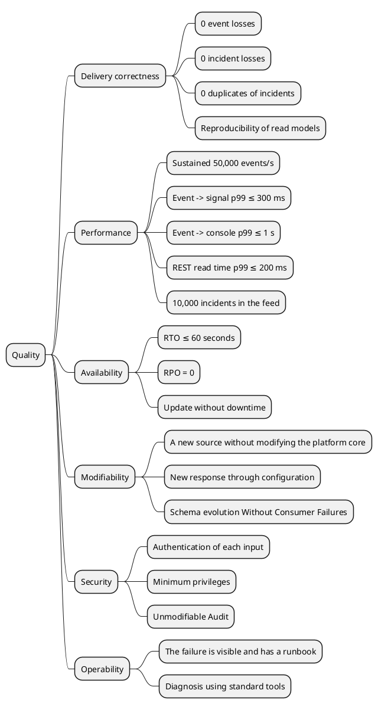

# Quality requirements and latency budgets

<!-- language-links -->
[English](quality.md) | [Русский](../ru/architecture/quality.md)
<!-- /language-links -->

Section 10 arc42. Quality goals are in [README](README.md#12-quality-goals); maintained SLOs and engineering quality requirements are in [requirements registry](../quality/requirements.yaml). Verification methods, gates and baselines are in [quality strategy](../quality/strategy.md) and [verification matrix](../quality/verification-matrix.md).

These are qualification targets and design budgets. Completed checks and outstanding release qualification are recorded in [release readiness](../product/release-readiness.md).

---

## 1. Quality Tree

## 2. Quality Scenarios

Format: Source -> Trigger -> Environment -> Response -> Metric.

### 2.1 Correctness and Availability

| ID | Trigger and Environment | Response | Metric |
|---|---|---|---|
| QS-A1 | The Correlation Engine instance fails mid-transaction at `LOAD-50K` | Partitions are reassigned, state is restored from changelog, processing continues with a fixed offset | 0 lost and 0 duplicate signals; recovery ≤ 30 seconds |
| QS-A2 | The Connector Gateway fails after a batch is written to Kafka, before the connector is confirmed | SDK reconnects and sends the batch; Normalizer removes duplicates | 0 losses, 0 duplicates in `psim.events.normalized.v1` |
| QS-A3 | The Incident Service receives the same signal repeatedly (repetition after failure) | Inbox discards duplicates | Number of incidents equals the target |
| QS-A4 | The connector loses connection for 10 minutes under normal source load | SDK buffers on disk and sends again after recovery | 0 losses; buffer delivery ≤ 2 minutes after reconnecting |
| QS-A5 | Any one cluster node fails under `LOAD-50K` | Kafka selects new leaders, PostgreSQL switches to synchronous replication, services redistribute partitions | RTO ≤ 60 seconds, RPO = 0 |
| QS-A6 | Projections are removed | Projections are rebuilt by replaying Kafka | Result is identical to the working one |

### 2.2 Performance

| ID | Trigger and Environment | Response | Metric |
|---|---|---|---|
| QS-P1 | `LOAD-50K` for 10 minutes | Pipeline processes stream without increased lag | Consumer lag does not increase; SLOs for delays are met |
| QS-P2 | Event ending the `conjunction` rule at `LOAD-50K` | Signal is published | Event -> signal p99 ≤ 300 ms |
| QS-P3 | New incident at `LOAD-50K` with 500 open consoles | Incident is delivered and rendered | Event -> console p99 ≤ 1 second |
| QS-P4 | Peak ×1.5 (75,000 events/s) for 5 minutes | Delay increases within budget, lag dissipates after peak | Lag returns to normal ≤ 5 minutes after peak; 0 losses |
| QS-P5 | Operator opens incident card | REST request is served | p99 ≤ 200 ms |
| QS-P6 | 10,000 active incidents in the feed | Scrolling and filtering | ≥ 50 frames/s |

### 2.3 Modifiability

| ID | Trigger and Environment | Response | Metric |
|---|---|---|---|
| QS-M1 | Integrator adds a new type of equipment | SDK connector and mapping rules | 0 changes to core code or images |
| QS-M2 | Administrator adds a new correlation rule | Rule is validated, tested, and activated | No service restarts; applied atomically |
| QS-M3 | Developer adds an optional field to the event schema | CI checks compatibility | Old consumers work unchanged |

### 2.4 Security

| ID | Trigger and Environment | Response | Metric |
|---|---|---|---|
| QS-S1 | Connector with revoked certificate is connected | Failure in handshake or registration | Session does not open; audit record |
| QS-S2 | Operator requests an incident from another site via API | ABAC failure | `403`; audit record `AccessDenied` |
| QS-S3 | Audit record is modified in the database | Integrity check | Violation detected with precision up to the record |

### 2.5 Operability

| ID | Trigger and Environment | Response | Metric |
|---|---|---|---|
| QS-O1 | Update N -> N+1 in the cluster under `LOAD-50K` | Sequential replacement of instances, expand/contract migrations | No interval > 5 seconds without new signals; SLOs for delays are met |
| QS-O2 | Any failure from chaos testing plan | Failure visible on the dashboard | Alert with reference to runbook ≤ 2 minutes |
| QS-O3 | Incident support | Collecting CLI diagnostic package | One command; package without secrets |

---

## 3. Decomposition of SLO by Components

| SLO | Component Contributions | Mechanism | Verification |
|---|---|---|---|
| 50,000 events/s, peak ×1.5 | Each hot path service with [scaling.md](scaling.md#53-service-instances-at-50000-eventss-cluster) instance maintains ≥ 1.5 × its share; Kafka ≥ 75,000 records/s on topic | Partitioning, batch processing | Load tests for gateway, normalization, and correlation |
| Event -> signal p99 ≤ 300 ms | SDK + network 15, gateway 25, Normalizer 30, Correlation 100, reserve 130 | Section 4 | Histograms by stages; load qualification |
| Event -> console p99 ≤ 1 second | Before signal 170, Incident 50, outbox 30, realtime 200, rendering 50, reserve 500 | Section 4 | Playwright with event time measurement; load qualification |
| REST reading p99 ≤ 200 ms | API Gateway 15, service or projection 120, network and serialization 30, reserve 35 | Reading from Redis and indexed PostgreSQL | Load test for API |
| 0 losses of events | SDK: buffer on disk; gateway: confirmation after `acks=all`; Normalizer, Correlation: EOS-K; Kafka: RF 3, `min.insync.replicas` 2 | [data-flows.md](data-flows.md#2-semantic-classes) | Cross-checking `source_seq`; SIM; CHAOS |
| 0 losses of incidents | Incident Service: commit before offset commit; PostgreSQL: synchronous replication; outbox | EOS-DB, outbox | SIM; CHAOS |
| 0 duplicates of incidents | Deterministic `signal_id`; inbox; unique open `grouping_key` (I3); key `psim.signals.v1` = `grouping_key` | [aggregates.md](../domain/aggregates.md#42-aggregate-incident) | SIM 10,000 runs |
| RTO ≤ 60 seconds | Detection of failure 10 (configured consumer group session timeout); rebalancing 5; recovery of correlation state ≤ 30 seconds; PostgreSQL switching ≤ 30 seconds (parallel); reserve 15 | KIP-848 rebalancing and Patroni | Chaos tests |
| RPO = 0 | Kafka `acks=all` + `min.insync.replicas=2`; PostgreSQL synchronous replication | - | Chaos tests |
| Update without downtime | Compatibility of N ↔ N+1 schemas; expand/contract; sequential replacement with draining | [deployment.md](deployment.md#4-update) | S12 |
| 10,000 incidents in the feed | Projection: snapshot of feed with one request; client: virtualization, deltas via WebSocket | - | Playwright |

---

## 4. Delay Budget

The delay is measured from the `occurred_at` event (time at the source). Values are p99 in milliseconds. Stage budgets are engineering allocations. End-to-end p99 must be measured separately; summing stage p99 values does not guarantee an upper bound for end-to-end p99.

### 4.1 Event -> Signal (≤ 300 ms)

| Stage | Section | Budget | What happens |
|---|---|---|---|
| B1 | Connector -> Gateway | 15 | Packaging in the SDK (`linger` 5 ms), network, gRPC |
| B2 | Gateway -> `psim.ingest.raw.v1` | 25 | Validation, writing from `acks=all` |
| B3 | Normalizer | 30 | Reading, mapping, enrichment, transaction and visibility for `read_committed` |
| B4 | Correlation Engine | 100 | Reading, rule calculation, state writing, transaction (commit interval ≤ 50 ms) |
| | **Total** | **170** | Reserve 130 |

For rules with redistribution (key wider than the zone), an additional stage B4' is added - 100 ms; total 270 ms, within the SLO. For rules `threshold` and `absence`, the delay is calculated from the moment the window closes according to the watermark, not from the event.

### 4.2 Event -> Incident in Console (≤ 1,000 ms)

| Stage | Section | Budget | What happens |
|---|---|---|---|
| B1-B4 | Before signal | 170 | See 4.1 |
| B5 | Incident Service | 50 | Reading signal, PostgreSQL transaction: inbox, aggregate, outbox |
| B6 | Outbox relay | 30 | Awakening based on `LISTEN/NOTIFY`, publishing |
| B7 | API Gateway realtime | 150 | Reading `psim.incidents.events.v1`, ABAC filtering, sending to WebSocket |
| B8 | Network to browser | 50 | - |
| B9 | Rendering in browser | 50 | Applying delta, rendering feed row, sound |
| | **Total** | **500** | Reserve 500 |

Projections do not occur on the path of the incident in the console: the client receives a snapshot from the Projection Service along with offsets at which the snapshot is aligned, and then receives deltas from Kafka through the realtime channel from these offsets ([crosscutting.md](crosscutting.md#9-realtime-snapshot-and-deltas)).

### 4.3 Other budgets

| Path | SLO | Distribution |
|---|---|---|
| Command: request -> delivery to connector | ≤ 200 ms | API Gateway 10, Command Service 20, outbox 30, gateway reads command 30, delivery to session 20; total 110, reserve 90 |
| Catalog change -> consumers | ≤ 2 s | Outbox 30, reading and applying copy 100; total 130 |
| SLA timer activation | ≤ 1 s error | Timer polling interval 200 ms, processing 100 |
| Signal -> processing by Incident Service | ≤ 50 ms | B5 |
| Aggregate change -> projection | ≤ 100 ms | Outbox 30, Projection 70 |

### 4.4 How it is measured

- Each stage adds a time tag `psim-ts-<stage>` to Kafka headers and writes a histogram `psim_stage_latency_seconds{stage}` (from input to output of the stage) and `psim_e2e_latency_seconds{stage}` (from `occurred_at` to output of the stage).
- The browser in test mode reports the time of incident rendering; Playwright associates it with `occurred_at`.
- Node clock is synchronized (chrony); synchronization errors are controlled by a metric and are included in the error.
- Regression of stage delay greater than 5% against the baseline blocks merging.
