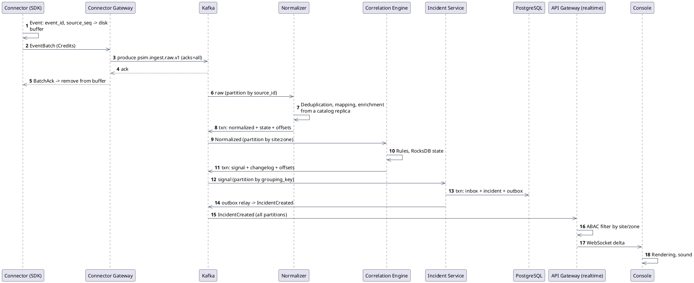
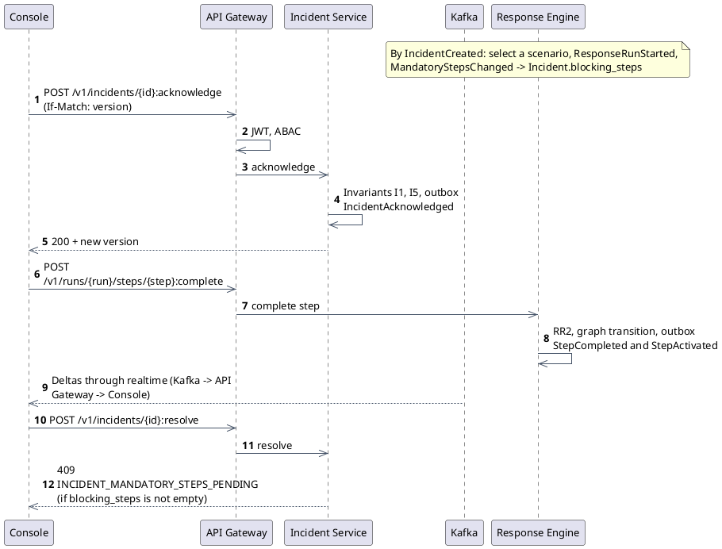
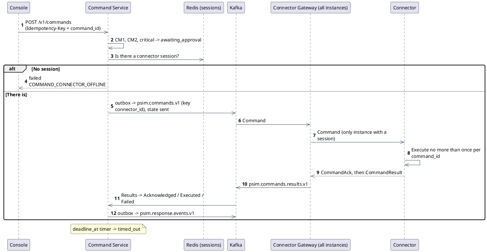
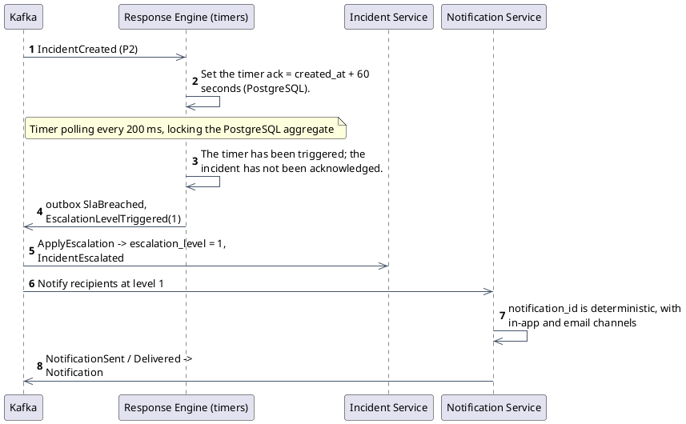
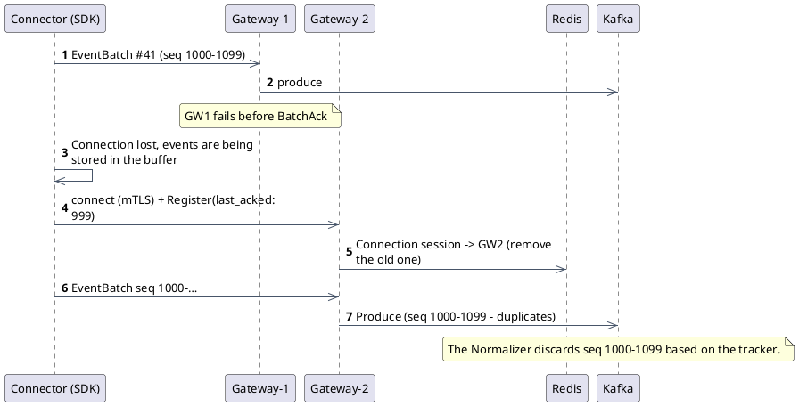
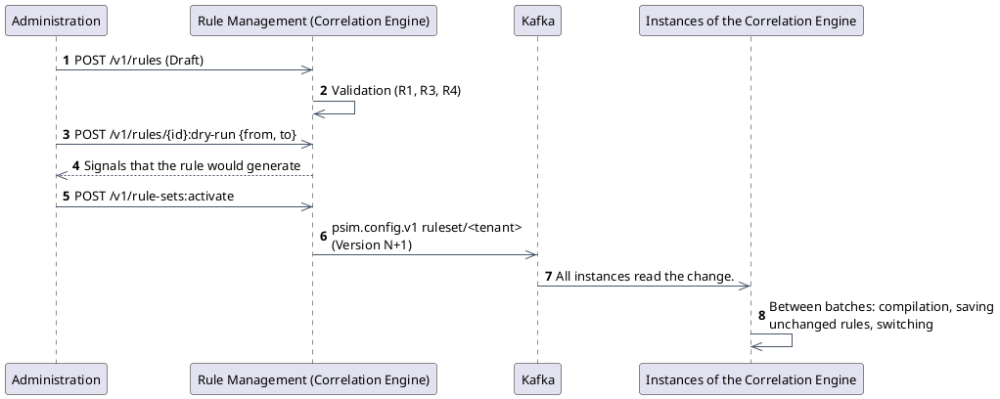

# Runtime View

<!-- language-links -->
[English](runtime-view.md) | [Русский](../ru/architecture/runtime-view.md)
<!-- /language-links -->

Section 6 arc42. Key interaction scenarios between components. The numbers of stages B1-B9 are from [the delay budget](quality.md#4-delay-budget).

---

## R1. Event -> Incident in the console (S3-S6)

## R2. Incident Acceptance and Response Scenario (S7)

`blocking_steps` is updated in the Incident Service based on Response events. To prevent resolving an incident while the event activating a mandatory step is still in transit, the Response Engine publishes `MandatoryStepsChanged` in the same transaction as the activation of that step. When `resolve`, the Incident Service additionally checks whether the response-run events have been applied to a version known to the client (which the client provides in its request).

## R3. Device Command (S8)

## R4. SLA escalation (S9)

## R5. Reconnecting the connector after a failure (S11)

## R6. Activation of a set of rules (S4)

## R7. Failure of the Correlation Engine instance (S11, QS-A1)

1. With `group.protocol=consumer`, the broker removes an unresponsive member after `group.consumer.session.timeout.ms` (45 s by default, 10 s in the local profile). The classic fallback uses `session.timeout.ms`.
2. The consumer protocol incrementally reassigns partitions; the classic fallback uses cooperative rebalancing.
3. The new owner initializes the transaction producer with the same `transactional.id` - unfinished transactions from the previous owner are interrupted by the broker.
4. The partition state is restored from `psim.correlation.changelog.v1` to the local RocksDB state. The ≤ 30 s recovery target requires qualification under the declared load and failure model.
5. Reading continues with the committed offset; signals published in interrupted transactions are invisible to `read_committed` consumers and will be republished with the same `signal_id`.

## Audit and Independent Verification

Producers publish actions through the outbox in `psim.audit.v1`; the Audit Service reads the available history from the beginning of retention. Keycloak events are imported by a read-only client with a persistent cursor. Two instances serialize the addition by a PostgreSQL lock for the tenant. The record contains a continuous number, previous hash, and the deterministic Protobuf hash.

The periodic checkpoint is signed with Ed25519 and synchronously recorded in an external archive. Then, a copy of it and the Kafka outbox are stored via a database transaction. The verification process recomputes record hashes and compares the archive independently of the checkpoint tables. The export records its own chain head and contains the entire chain; `psim-audit-tool` verifies it without using the database or network, using separately authorized keys. [Guide](../engineering/audit-service.md) describes the permissions, protection limits, and recovery procedures.

The diagrams describe protocol boundaries. A physical device action is not guaranteed exactly once; an unknown command outcome must be reconciled before a new command is issued. See [command handling](../engineering/command-service.md) and [release readiness](../product/release-readiness.md).
