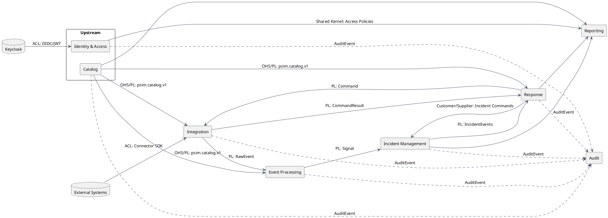

# Bounded contexts and context maps

<!-- language-links -->
[English](context-map.md) | [Русский](../ru/domain/context-map.md)
<!-- /language-links -->

## 1. Contexts

| Context | Responsibility | Services | Data Owned by |
|---|---|---|---|
| **Integration** | Connector connectivity, raw event intake, command delivery | Connector SDK, Connector Gateway | Persistent registrations and recovery state (PostgreSQL), ephemeral sessions (Valkey) |
| **Catalog** | Model of protected objects, devices, sources, connectors | Resource Catalog | Locations, devices, sources, types, connector metadata, floor plans |
| **Event Processing** | Normalization, enrichment, storage of normalized events, correlation, rules | Normalizer, Event History, Correlation Engine, rule management | Mapping rules, correlation rules, rule sets, correlation state, normalized events |
| **Incident Management** | Lifecycle of incidents, signal grouping, assignment, chronology | Incident Service | Incidents, incident types |
| **Response** | Response scenarios, commands to devices, SLA, escalation, notifications | Response Engine, Command Service, Notification Service | Scenarios, executions, commands, escalation policies, notifications, timers |
| **Identity & Access** | Users, roles, access scopes, access decisions | Keycloak, policy library, API Gateway | Role and access scope assignments |
| **Audit** | Unchangeable action logs | Audit Service | Audit records, checkpoints |
| **Reporting** | Read models for consoles and reports | Projection Service, Report API | Console read models and report facts |
| **Platform** | General mechanisms: message envelope, configuration, observability, DLQ | Runtime, libraries, CLI | System configuration, retention |

## 2. Context maps

Notations: **PL** - Published Language (versioned Protobuf schema in the topic); **OHS** - Open Host Service; **ACL** - Anti-Corruption Layer; **Customer/Supplier** - a downstream context influences the upstream contract; **Shared Kernel** - shared library.

## 3. Relationships

| Upstream -> Downstream | Type | Channel | Note |
|---|---|---|---|
| External systems -> Integration | ACL | Connector SDK, gRPC | The external device model is translated into `RawEvent` in the connector, the core does not know about manufacturers |
| Integration -> Event Processing | PL | `psim.ingest.raw.v1` | Integration does not interpret event content, only checks schema and rights |
| Catalog -> Event Processing, Integration, Response | OHS + PL | `psim.catalog.v1` (compacted) | Consumers hold a local copy of the catalog and do not access Catalog synchronously during hot paths |
| Event Processing -> Incident Management | PL | `psim.signals.v1` | Incidents do not know rules; signal is self-sufficient: incident type, priority, grouping key |
| Incident Management -> Response | PL | `psim.incidents.events.v1` | Response runs scenarios and SLA timers based on incident events |
| Response -> Incident Management | Customer/Supplier | `psim.response.events.v1` | Incidents account for unfinished required steps during resolution and reflect steps in chronological order |
| Response -> Integration | PL | `psim.commands.v1`, `psim.commands.results.v1` | Command Service owns the lifecycle of commands, gateway only delivers them to the session |
| Keycloak -> Identity & Access | ACL | OIDC, JWKS | Roles and access scopes are mapped to the internal model `Principal` |
| All -> Audit | Conformist (Audit adapts) | `psim.audit.v1` | Each context publishes audit records in a common format; Audit does not interpret them |
| All -> Reporting | Conformist | domain topics | Rebuild requires the retained source history and, where necessary, a compatible snapshot or backup |
| Platform -> All | Shared Kernel | libraries | Container, runtime, errors, observability, time abstraction |

## 4. Boundary rules

1. A context only changes its own data. External data is accessible to it as a local copy from the topic or through a request to the owner’s API outside of the hot path.
2. Inter-context interaction during the hot path is only through Kafka. Synchronous calls are allowed for user operations (REST through API Gateway) and for reading reference data outside of the hot path.
3. The domain core of each context is a library that has no dependencies on Kafka, PostgreSQL, Redis, network, or system time. It is tested for dependency architecture checks.
4. Identifiers of external aggregates are stored as values; references to external objects are not dereferenced within a transaction.
5. Contracts between contexts (Protobuf schemas) are public versioned artifacts in the `contracts/` directory.

## 5. Extensions for AI (ADR-025)

Extension points for event analysis, response handlers and operator assistance:

- **Topic consumer** - A new context reads `psim.events.normalized.v1` or `psim.signals.v1` and publishes its signals in `psim.signals.v1` as another “rule”.
- **Scenario step** - The `automated` type of step calls an external handler through a webhook and receives recommendations.
- **Operator assistant** - A consumer of projections and APIs with only reading roles.

## 6. Operational additions (ADR-042)

Catalog owns maintenance intervals and floor-plan metadata; Integration defines availability and source reconciliation, Projection builds data quality status; Incident is responsible for responsibility handover; Response Engine owns duty assignments. Platform libraries provide FileStore and trust mechanisms. Diagnostic replay is run using operational tools in a separate context. [Models and invariants](../architecture/operational-capabilities.md).
