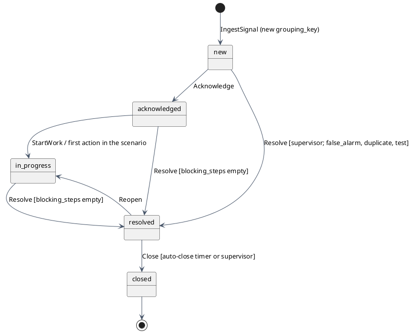
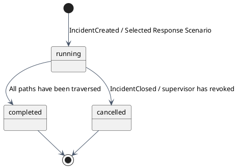
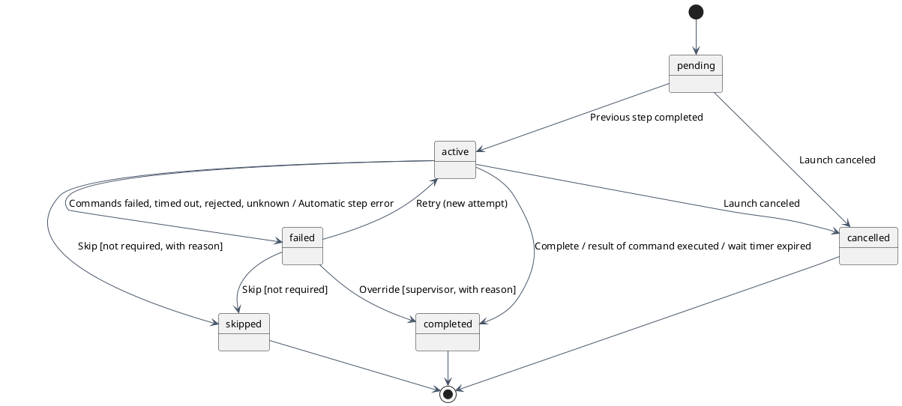
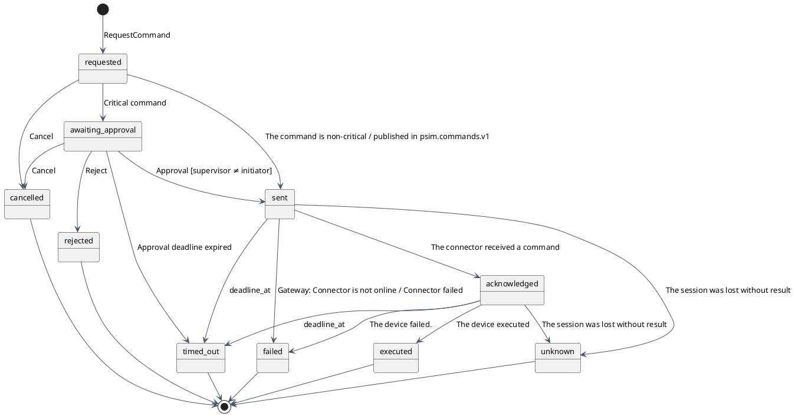
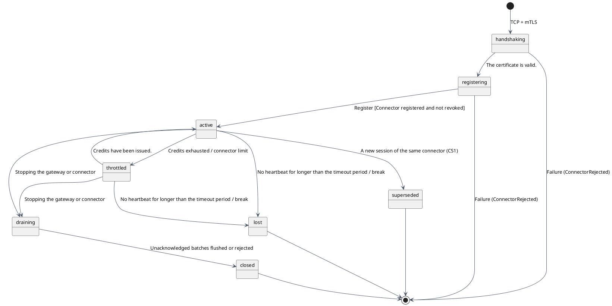
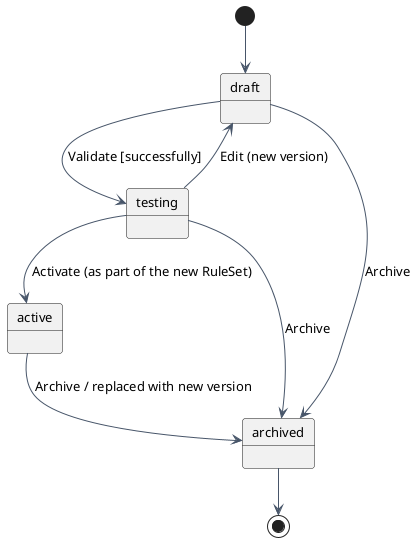
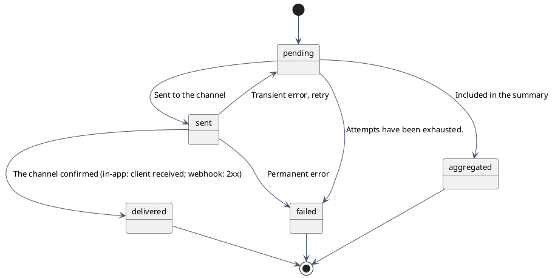

# State Models

<!-- language-links -->
[English](state-models.md) | [Русский](../ru/domain/state-models.md)
<!-- /language-links -->

Diagrams are in the PlantUML format. Transitions outside the diagram are rejected by the domain core with codes `INCIDENT_INVALID_STATE_TRANSITION`, `COMMAND_INVALID_STATE`, or similar context codes from the [error catalog](../../contracts/errors/errors.yaml). Each transition generates a domain event from [aggregates.md](aggregates.md) and an audit record.

---

## 1. Incident

| From | Action | To | Who | Conditions |
|---|---|---|---|---|
| - | `IngestSignal` | `new` | System | No open incident with this `grouping_key`, or the grouping window has expired (I3, I4) |
| `new`, `acknowledged`, `in_progress` | `IngestSignal` | unchanged | System | Signal linked, priority recalculated (I6) |
| `new` | `Acknowledge` | `acknowledged` | Operator, supervisor | The acknowledging user becomes the assignee; the access scope includes the zone (I5) |
| `acknowledged` | `StartWork` | `in_progress` | Assignee | Explicitly or automatically upon the first executed step of the scenario or first command |
| Any open | `Assign`, `Reassign` | unchanged | Supervisor; Operator - only for oneself | The new responsible person corresponds to I5 |
| `new` | `Resolve` | `resolved` | Supervisor | Only with the resolution `false_alarm`, `duplicate`, or `test` - for mass false alarms |
| `acknowledged`, `in_progress` | `Resolve` | `resolved` | Assignee, supervisor | `blocking_steps` is empty (I7) |
| `resolved` | `Reopen` | `in_progress` | Assignee, supervisor | Until closed (I10) |
| `resolved` | `Close` | `closed` | System by timer, supervisor | Final state (I8) |

**Escalation** - An orthogonal attribute, `escalation_level`, not a state. It is possible in `new`, `acknowledged`, and `in_progress` and does not change states. In the interface, an escalated incident is displayed with a separate tag.

**“False”** - This is the value of the resolution `resolution = false_alarm`, not a separate state. This maintains a single path to closure and simplifies metrics: the proportion of false alarms is calculated based on the resolution.

The separation of lifecycle, escalations, and resolution results is documented in [ADR-027](../adr/0027-incident-states.md).

---

## 2. Scenario Execution

### 2.1 Execution

If no scenario fits the incident, execution is not initiated; with `IncidentType.response_required = true`, a warning is recorded in the timeline, and the incident is considered without a scenario in the metrics.

### 2.2 Step

- The step `decision` ends with the selection of an option; the selected branch’s step is activated, and other branches are not activated and are considered uncompleted in the report.
- Steps `notify`, `escalate`, `automated`, and `wait` are executed by the system without operator involvement.
- A required step in `failed` blocks incident resolution until it is successfully repeated or `supervisor` ends it with a reason (`Override`).

---

## 3. Command

| State | Meaning |
|---|---|
| `requested` | Request accepted and authorized (CM1, CM2) |
| `awaiting_approval` | Waiting for confirmation from the second user (CM3) |
| `sent` | The delivery is saved in the outbox; the gateway sends it to the selected session of the connector |
| `acknowledged` | The connector has confirmed receipt |
| `executed` | The connector reported successful execution by the device |
| `unknown` | The session is lost without a final result; automatic re-execution is prohibited |
| `failed`, `rejected`, `timed_out`, `cancelled` | Final unsuccessful states with a reason |

Re-delivery to the connector with the same `command_id` is allowed: the connector (SDK) must execute the command no more than once and return the saved result. This is SDK deduplication, not a guarantee of exactly-once physical execution; an ambiguous device outcome remains unknown.

---

## 4. Connector Session

- When transitioning to `lost` or `superseded`, unacknowledged batches are considered not received; the SDK re-delivers them from the buffer in a new session, duplicates are removed according to `event_id` and `source_seq`.
- Commands that could not be delivered due to lack of a session receive the result `failed` with a reason `COMMAND_CONNECTOR_OFFLINE`; re-delivery is not performed when the session is restored in MVP to avoid executing outdated commands.

---

## 5. Correlation Rule

In the state `testing`, a trial run on historical data is available; trial run signals are not published in `psim.signals.v1`.

---

## 6. Notification

For email, the state `delivered` means that the SMTP server has accepted it: confirmation of delivery to the recipient in MVP does not occur.

## 7. Operational States (ADR-042)

| Model | Transitions and Invariants |
|---|---|
| DeviceState quality | unknown -> actual after confirmation; actual -> stale based on freshness; loss of connection or start of re-check requires a new confirmation. Replaying an old buffer does not restore actual quality |
| MaintenanceWindow | scheduled -> active based on start time; active -> ended based on expiration or explicit completion; scheduled -> ended when canceled. Final state is not resumed; new maintenance - new window |
| HandoverRequest | pending -> accepted or rejected/cancelled; until responsibility is taken, the previous one remains. Each batch row records a successful transfer or conflict, re-execution does not repeat it |
| ReplayRun | pending -> running -> completed/failed/cancelled; any path maintains isolation from production actions |

The precision of maintenance boundaries is ≤ 1s; expired windows are closed after restart. Detailed semantics - in [operational-capabilities.md](../architecture/operational-capabilities.md).
