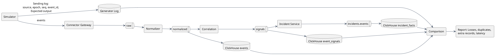

# Event Loss and Duplicate Reconciliation

<!-- language-links -->
[English](reconciliation.md) | [Русский](../ru/quality/reconciliation.md)
<!-- /language-links -->

Objective: To prove “0 lost events, 0 lost incidents, 0 duplicate incidents” in load and chaos tests, rather than assuming this to be the case. Goals G-05 and G-06 are verified through cross-checking with the simulator during load and failures.

This is the qualification protocol. Available evidence and outstanding qualification requirements are listed in [release readiness](../product/release-readiness.md).

---

## 1. Concept

The load generator knows what it has sent; the platform keeps track of what it has received and what results were obtained from those. The cross-check compares two sets of unique keys, which the platform must maintain unchanged throughout the pipeline.

## 2. Keys for Cross-Checking

| Level | Key | Expected Source | Actual Source |
|---|---|---|---|
| Events | `(source_id, source_epoch, source_seq)` and `event_id` | Generator log: each event with confirmed sending (`BatchAck`) and each event in the SDK buffer at the end of the test | ClickHouse `events` (all events, ADR-028) and, for verification, reading `psim.events.normalized.v1` |
| Signals | `signal_id` (deterministic, ADR-005) | Scenario oracle: the generator generates events according to scenarios with known correlation results | `psim.signals.v1`, ClickHouse `event_signals` |
| Incidents | `grouping_key` + window | Scenario oracle | `psim.incidents.events.v1`, ClickHouse `incident_facts`, PostgreSQL Incident Service |

The generator log is a file or table ClickHouse `loadgen_ledger`, separate from the platform’s data, so that the cross-check does not depend on the system being tested.

## 3. Scenario Oracle

Background load (`LOAD-50K`) consists of events that do not generate signals and **scenario inserts** with known results:

| Insert | Expected Result |
|---|---|
| Pair “perimeter + video analytics” in one zone within the window | 1 signal, 1 incident |
| Same pair with an interval longer than the window | 0 signals |
| Repetition of the pair in the grouping window | 1 incident with 2 signals |
| N consecutive events at the threshold | 1 signal |
| Absence of expected heartbeat | 1 signal after the window closes |
| Late events within the allowable delay | Counted |
| Late events beyond the allowable delay | Not counted, but included in the metric |

The oracle calculates expected signals and incidents using the same rules as in the reference single-threaded implementation of the domain core without infrastructure (the same domain code, different adapter), so expectations do not depend on partitioning or failures.

## 4. Algorithm

1. **Preparation.** Clean state or a timestamp of start time; the generator records seeds, profiles, and list of inserts.
2. **Execution.** Load and, for chaos tests, insertion of failures according to experimental scenarios.
3. **Draining.** The generator stops; waiting until all consumer group lags reach 0 and SDK buffers are empty, but not longer than the deadline (default 10 minutes).
4. **Event Checking.** For each source: compare the expected and actual key sets. Expected keys absent from the actual set are lost; actual keys absent from the expected set are extra; multiplicity greater than the expected count identifies duplicates.
5. **Signal and Incident Checking.** Comparison with the oracle using `signal_id` and `grouping_key`; an incident with the same `grouping_key` in one window more than once is a duplicate.
6. **Report.** Number and examples for each category; distribution of delays (in [latency-measurement.md](latency-measurement.md)); list of inserted failures with time.

## 5. Criteria

| Category | Threshold |
|---|---|
| Lost events | 0 |
| Duplicates in `psim.events.normalized.v1` | 0 (EOS-K, ADR-006) |
| Extra events | 0 |
| Lost signals and incidents | 0 |
| Duplicates of incidents | 0 |
| Events discarded by SDK overflow policy | 0. A full buffer rejects new enqueue attempts and applies backpressure; accepted events remain queued. The `info` class is not an eviction exception. Record overflow attempts in `system.connector.buffer_overflow`. |

Any violation is a test failure; the report retains data for reproduction (seeds, failure times, deviation ranges).

## 6. Cross-Checking in Simulation

In the simulation environment (ADR-044), the same algorithm is executed in memory after each execution: thousands of executions with different seeds and failure schedules. Simulation checks the domain model across reproducible schedules; integration reconciliation separately checks the implementation on real infrastructure.
