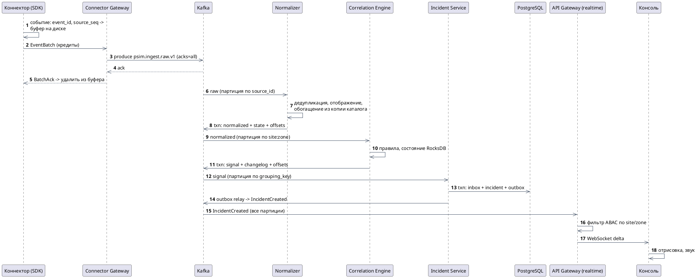
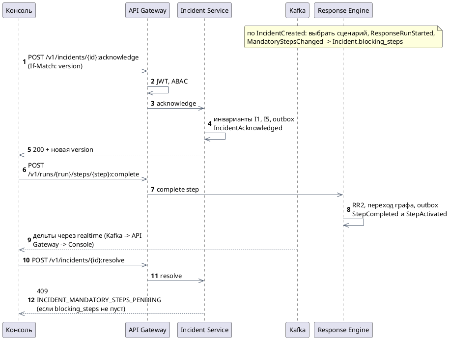
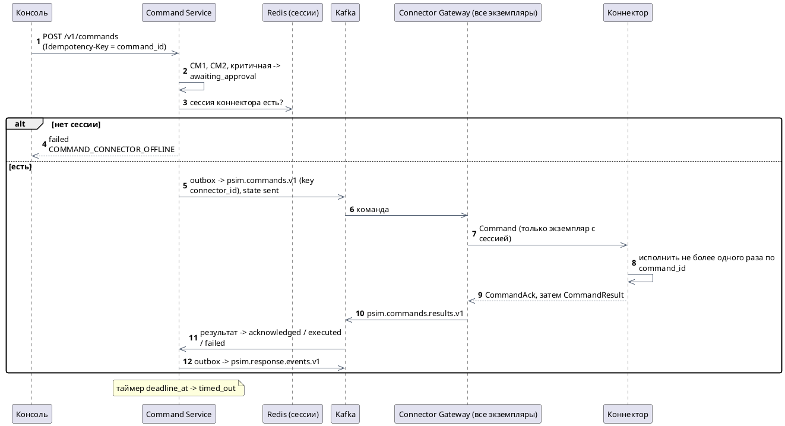
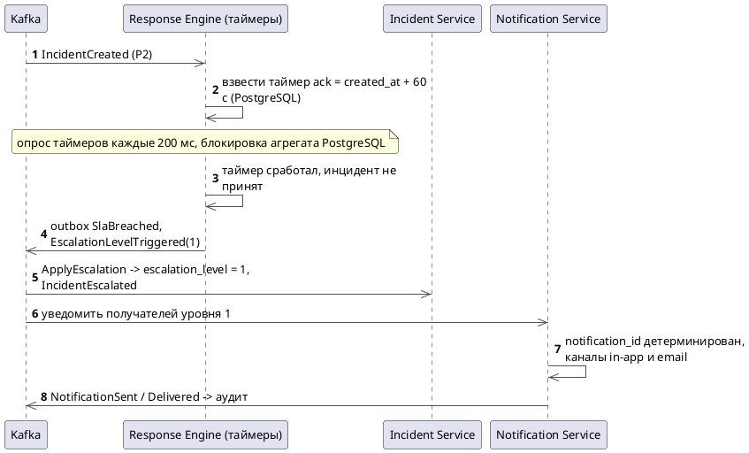
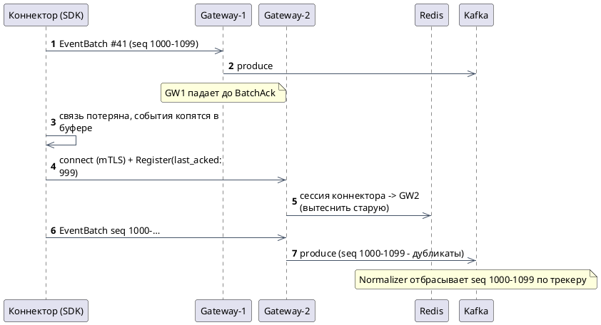
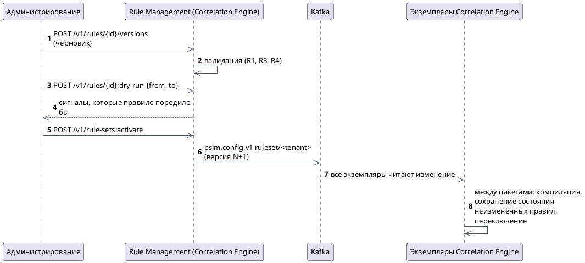

# Представление времени выполнения

<!-- language-links -->
[English](../../architecture/runtime-view.md) | [Русский](runtime-view.md)
<!-- /language-links -->

Раздел 6 arc42. Ключевые сценарии взаимодействия компонентов. Номера этапов B1-B9 - из [бюджета задержек](quality.md#4-бюджет-задержек).

---

## R1. Событие -> инцидент в консоли (S3-S6)

## R2. Принятие инцидента и сценарий (S7)

`blocking_steps` обновляется в Incident Service по событиям Response в конечном счёте. Чтобы исключить решение инцидента, пока событие о новом обязательном шаге ещё в пути, Response Engine публикует `MandatoryStepsChanged` в той же транзакции, что и активацию шага; Incident Service при `resolve` дополнительно проверяет, что применил события запуска до версии, известной клиенту (клиент передаёт её в запросе).

## R3. Команда на устройство (S8)

## R4. Эскалация по SLA (S9)

## R5. Переподключение коннектора после обрыва (S11)

## R6. Активация набора правил (S4)

## R7. Отказ экземпляра Correlation Engine (S11, QS-A1)

1. При `group.protocol=consumer` брокер исключает неотвечающего участника через `group.consumer.session.timeout.ms` (45 с по умолчанию, 10 с в локальном профиле). Классический fallback использует `session.timeout.ms`.
2. Consumer protocol постепенно перераспределяет партиции; классический fallback использует кооперативную ребалансировку.
3. Новый владелец инициализирует транзакционный продюсер с тем же `transactional.id` - незавершённые транзакции старого владельца прерываются брокером.
4. Состояние партиции восстанавливается из `psim.correlation.changelog.v1` в локальный RocksDB. Цель восстановления ≤ 30 с требует квалификации при объявленных нагрузке и модели отказов.
5. Чтение продолжается с зафиксированного смещения; сигналы, опубликованные в прерванной транзакции, невидимы для `read_committed`-потребителей и будут опубликованы повторно с теми же `signal_id`.

## Аудит и независимая проверка

Производители публикуют действия через outbox в `psim.audit.v1`; Audit Service читает доступную историю с начала retention. Keycloak импортируется read-only клиентом с долговечным курсором. Два экземпляра сериализуют добавление блокировкой PostgreSQL на тенант. Запись содержит непрерывный номер, предыдущий хэш и хэш детерминированного Protobuf.

Периодическая контрольная точка подписывается Ed25519 и синхронно записывается во внешний архив, затем её копия и Kafka outbox фиксируются транзакцией БД. Проверка пересчитывает записи и сверяет архив независимо от таблицы контрольных точек. Экспорт фиксирует свою вершину и содержит всю цепочку; `psim-audit-tool` проверяет её без БД и сети по отдельно доверенным ключам. [Руководство](../engineering/audit-service.md) описывает права, границы защиты и восстановление.

Диаграммы описывают границы протоколов. Для физического действия устройства нет гарантии exactly once; неизвестный исход команды необходимо согласовать до выдачи новой команды. См. [обработку команд](../engineering/command-service.md) и [готовность к выпуску](../product/release-readiness.md).
