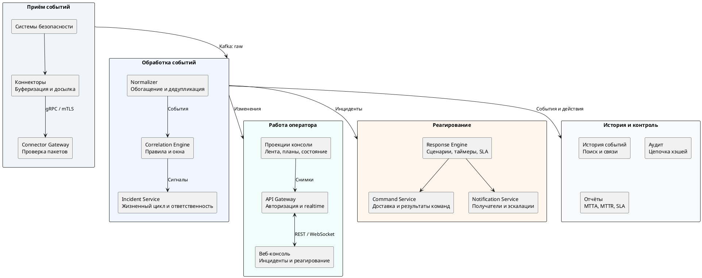

# Open-Source PSIM Platform

<!-- language-links -->
[English](../../../README.md) | [Русский](README.md)
<!-- /language-links -->

Открытая вендор-нейтральная платформа управления ситуациями в физической безопасности (PSIM, Physical Security Information Management). Объединяет события охранных и пожарных систем, СКУД, видеоаналитики и инженерной инфраструктуры в единый процесс: обнаружение ситуации, реагирование, закрытие инцидента и отчёт.

Платформа предназначена для служб безопасности, ситуационных центров и интеграторов. Рассчитана на самостоятельное развёртывание в локальной или облачной инфраструктуре. Серверная часть написана на C++, веб-консоль - на React и TypeScript. Лицензия - [MIT](../../../LICENSE).

[Быстрый старт](#быстрый-старт) · [Документация](../README.md) · [Архитектура](../architecture/README.md) · [Готовность выпуска](../product/release-readiness.md) · [Участие](CONTRIBUTING.md)

## Возможности

- **Интеграция оборудования.** Протокол коннекторов по gRPC, C++ SDK, дисковая буферизация и досылка событий. В репозитории доступны симулятор и эталонный Webhook/HTTP-коннектор.
- **Обработка событий.** Нормализация, обогащение, дедупликация, история и поиск. Корреляция по условиям, временным окнам, последовательностям и отсутствию событий.
- **Работа с инцидентами.** Общая лента, планы объектов и состояние устройств, назначение ответственных, подтверждённая передача ответственности и обновления через WebSocket.
- **Реагирование.** Сценарии, чек-листы, команды на устройства, контроль SLA, эскалации и уведомления.
- **Аудит и отчётность.** История действий с цепочкой хэшей и проверкой целостности, экспорт, показатели MTTA, MTTR и соблюдения SLA.
- **Администрирование и эксплуатация.** Каталог объектов и устройств, ролевой доступ, обслуживание, диагностика, управление сертификатами, резервное копирование и восстановление.
- **Ассистент и учения.** Сводки по разрешённым источникам, подключение локального провайдера модели и изолированные учебные сценарии.

Подробности: [назначение продукта](../product/product-brief.md), [роли и рабочие сценарии](../product/roles-and-journeys.md), [границы MVP](../product/mvp-scope.md).

## Состояние проекта

Проект находится в разработке MVP. Реализованы основные серверные сервисы, операторская консоль, интерфейсы администрирования, аудита и отчётов. Доступен локальный сквозной стенд: событие от коннектора проходит через обработку и отображается как инцидент в браузере.

До выпуска остаются полная сквозная верификация и эксплуатационная приёмка. В частности, ещё не подтверждены обновление и откат под целевой нагрузкой 50 000 событий/с, а также полное восстановление обеих топологий с независимым целевым хранилищем и измерением RPO/RTO. Реализованные функции и неподтверждённые условия перечислены в [готовности выпуска](../product/release-readiness.md); постоянные критерии - в [реестре качества](../../quality/requirements.yaml) и [спецификации приёмки](../product/acceptance-spec.md).

## Быстрый старт

Локальный стенд позволяет проверить путь события от симулятора до операторской ленты без подключения реального оборудования.

### Требования

Разработка, сборка и тестирование выполняются на Linux с нативным Docker Engine и плагином Docker Compose. На хосте нужны:

- Git.
- [Docker Engine и Docker Compose](https://docs.docker.com/engine/install/debian/).
- Python 3 с PyYAML, доступным для `python3 -I`.
- [Task 3.x](https://taskfile.dev/docs/installation).

Проверка окружения:

```bash
docker info
docker compose version
task --version
python3 -I -c "import yaml; print(yaml.__version__)"
```

### Запуск стенда

```bash
git clone https://github.com/d8zerg/psim.git
cd psim
task flow:up
task flow:emit COUNT=3
```

`task flow:up` собирает необходимые компоненты и запускает инфраструктуру и прикладные процессы. `task flow:emit` отправляет синтетические тревоги через mTLS-коннектор.

Откройте [http://localhost:4173](http://localhost:4173), нажмите **Sign in** и войдите с учётной записью разработки:

| Поле | Значение |
|---|---|
| Логин | `operator1` |
| Пароль | `psim-dev-Passw0rd` |

В операторской ленте появятся инциденты, сформированные из отправленных событий. Адреса сервисов и учётные данные локального окружения выводит `task env:endpoints`.

### Остановка стенда

```bash
task flow:down
task env:down
```

Первая команда останавливает прикладные процессы, вторая - инфраструктуру с сохранением данных. Состав стенда, тестовая конфигурация и сквозные проверки описаны в [руководстве сквозного потока](../engineering/event-flow.md).

## Архитектура и стек

Основные потоки: приём событий, формирование инцидентов, работа оператора и исполнение сценариев реагирования.



Схема показывает логические этапы и основные потребители данных. Межсервисные события передаются через Apache Kafka; брокеры, отдельные топики и хранилища опущены. История, аудит и отчётность пополняются по мере обработки, включая действия оператора и результаты реагирования.

Оператор работает через API Gateway: назначает и подтверждает инциденты, выполняет шаги сценария и закрывает инцидент после обязательных действий. Gateway получает снимки от сервиса проекций, а realtime-изменения читает из Kafka и передаёт в консоль через WebSocket. Команды доставляются оборудованию через Connector Gateway и коннектор; результаты возвращаются в сервис команд и сценарий реагирования.

Сервисы разделены по доменным контекстам; доменное ядро отделено от инфраструктурных адаптеров.

| Область | Технологии |
|---|---|
| Сервер и SDK | C++23, Boost.Asio и Beast, gRPC, Protobuf |
| Событийные потоки | Apache Kafka в режиме KRaft, Schema Registry |
| Хранение данных | PostgreSQL, ClickHouse, RocksDB, Valkey, S3-совместимый SeaweedFS |
| Идентификация и доступ | Keycloak, OIDC, RBAC, области доступа, mTLS |
| Веб-клиент | React, TypeScript, Vite, TanStack, Zustand, Tailwind CSS |
| Наблюдаемость | OpenTelemetry, Prometheus, Grafana, Loki, Tempo |
| Сборка и зависимости | Clang, CMake, Ninja, Conan 2, Task, Docker |

Схемы компонентов, потоки данных и семантика доставки описаны в [архитектурной документации](../architecture/README.md). Публичные интерфейсы - в [контрактах](contracts/README.md), основания технических решений - в [реестре ADR](../adr/README.md).

## Развёртывание и эксплуатация

Целевая ОС - Debian 13 x86_64. Предусмотрены топологии одной машины и кластера на виртуальных машинах, DEB-пакеты и контейнерные образы без root. Техническое название стенда, образов и поставки - `psim-platform`.

Для административных операций используется C++ CLI `psimctl`, для сбора метрик узла и инфраструктуры - `psim-monitoring-agent`. Средства эксплуатации включают установку и обновление, диагностику, управление сертификатами, зашифрованные резервные копии во внешнем S3 и восстановление.

Инструкции и ограничения проверенных конфигураций:

- [Топологии и требования к развёртыванию](../engineering/deployment-topologies.md).
- [Установка, обновление и откат](../engineering/installation-and-upgrades.md).
- [Администрирование, резервное копирование и восстановление](../engineering/administration-and-recovery.md).
- [Мониторинг, логи, трассы и оповещения](../engineering/observability.md).

## Разработка

Используйте окружение из [быстрого старта](#требования). Компилятор, зависимости C++ и инструменты веб-разработки запускаются в контейнерах с закреплёнными версиями. Доступен [dev container](../../../.devcontainer/devcontainer.json), подключённый к Docker Engine Linux-хоста.

Сервисы, коннекторы, `psimctl` и продуктовая логика реализуются на C++. Python используется для вспомогательных задач сборки, генерации, развёртывания и тестирования. Подробности - в [правилах выбора языков](../engineering/product-runtime-languages.md).

| Команда | Назначение |
|---|---|
| `task cpp:test` | Сборка и тесты C++ |
| `task web:check` | Проверки и сборка веб-клиента |
| `task ci` | Локальный конвейер по области изменений |
| `task ci FULL=true` | Полный локальный конвейер |
| `task docs:check` | Проверка документации и сборка портала |
| `task web:dev` | Витрина дизайн-системы на `http://localhost:5173/design-system.html` |
| `task web:catalogue` | Каталог компонентов на `http://localhost:61000` |
| `task docs:portal` | Сборка портала документации в `build/portal/site/` |
| `task docs:serve` | Просмотр собранного портала на `http://localhost:8000` |

Витрина дизайн-системы использует демонстрационные данные. Устройство веб-клиента и его команды описаны в [web/README.md](web/README.md).

Для C++ доступны пресеты `debug`, `release`, `relwithdebinfo`, `asan`, `tsan`, `coverage`. Например, `task cpp:build PRESET=release JOBS=4` запускает release-сборку с четырьмя параллельными заданиями. Артефакты находятся в `build/debian13/<preset>/`, кэш - в `.cache/`.

Полный список команд: `task --list-all`. Рабочий процесс и проверки описаны в [CONTRIBUTING.md](CONTRIBUTING.md), управление локальной инфраструктурой - в [deploy/README.md](deploy/README.md).

## Структура репозитория

| Каталог | Назначение |
|---|---|
| `contracts/` | Protobuf, OpenAPI, AsyncAPI, реестры топиков, таксономии и ошибок |
| `libs/platform/` | Runtime, асинхронные примитивы и инфраструктурные библиотеки |
| `libs/domain/` | Доменные модели событий, корреляции, инцидентов и реагирования |
| `services/` | Сервисы по доменным контекстам |
| `connectors/` | SDK, симулятор и интеграции с внешними системами |
| `web/` | Веб-консоль, дизайн-система, REST- и realtime-клиенты |
| `deploy/` | Локальное окружение, образы и профили развёртывания |
| `tests/` | Системные, сквозные, нагрузочные и хаос-тесты |
| `tools/` | `psimctl`, агент мониторинга, миграторы, инструменты сборки, генераторы и проверки |
| `docs/` | Продукт, архитектура, ADR, инженерные руководства, безопасность и качество |

Модульные и компонентные тесты C++ находятся рядом с кодом. Репозиторий, код и пространства имён используют название `psim`.

## Участие, безопасность и лицензия

Предложения и ошибки принимаются через [GitHub Issues](https://github.com/d8zerg/psim/issues), изменения - через pull request. Порядок участия описан в [CONTRIBUTING.md](CONTRIBUTING.md).

О проблемах безопасности сообщайте по [SECURITY.md](SECURITY.md).

Код распространяется под лицензией [MIT](../../../LICENSE).
