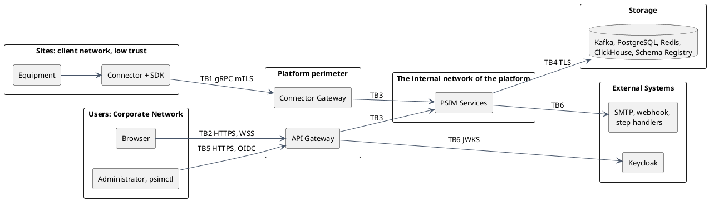

# Threat Model of Open-Source PSIM Platform

<!-- language-links -->
[English](threat-model.md) | [Русский](../ru/security/threat-model.md)
<!-- /language-links -->

This document describes the methodology, assets, boundaries of trust, and assumptions. The threat and security requirements registry is maintained in [threat-model.yaml](threat-model.yaml) (source of truth), with the readable tables being [threat-register.md](threat-register.md) (generated by the `task docs:threats:gen` task). The `task docs:threats` task ensures that each high-risk threat is addressed by a measure stronger than review, and each measure is assigned to existing components within the repository.

Required controls and release qualification are distinct: completed checks and outstanding conditions are listed in [release readiness](../product/release-readiness.md).

---

## 1. Methodology

1. **Decomposition** - The system is divided into trust boundaries (section 4) according to the architecture ([README](../architecture/README.md), [deployment.md](../architecture/deployment.md)).
2. **STRIDE** at each boundary: Spoofing, Tampering, Repudiation, Information Disclosure, Denial of Service, Elevation of Privilege.
3. **Risk assessment** = probability × damage, with each assessed on a scale of 1-3:

| Risk | Value | Requirement |
|---|---|---|
| High | 6-9 | A measure must be assigned to the responsible component; verification during security qualification |
| Medium | 3-4 | A measure with an assigned component and verification method or justified risk acceptance |
| Low | 1-2 | Risk acceptance is allowed, with records kept in the registry |

   Damage 3 - Threats to life and health (missed alarms), unauthorized physical interference (opening doors), compromise of the entire system. Damage 2 - Leakage of personal data, disruption of part of the system, violation of audit evidence. Damage 1 - Local inconvenience without security implications for the system.

4. **Measures** are defined as `SR-NN` security requirements with a scope, responsible components, and a verification method. One measure addresses multiple threats.
5. **Review** - At each ADR that affects trust boundaries, and during internal pentesting based on the threat model.

## 2. Domain Context and Characteristics

PSIM manages physical security: errors and attacks not only lead to data leaks but also **missed alarms** (fires, intrusions) and **unauthorized physical interference** through device commands (unlocking doors, disarming). Therefore, the integrity and availability of the alarm pipeline and command authorization are of utmost priority, above confidentiality.

## 3. Assets

| ID | Asset | Properties | Why Important |
|---|---|---|---|
| A1 | Event streams, signals, incidents | Integrity, availability | Substitution or loss - missed or false alarms |
| A2 | Device commands | Integrity, authorization | Physical action at the site |
| A3 | Audit logs | Integrity, availability | Evidence for investigations (S10) |
| A4 | Configuration: correlation rules and mappings, scenarios, catalogs, escalation policies | Integrity | Changing rules can disable response to threats |
| A5 | Keys and secrets: connector certificates, external PKI materials, audit checkpoint signing keys, service accounts | Confidentiality, integrity | Compromise gives access to the entire system |
| A6 | User accounts and sessions | Confidentiality, integrity | Actions performed as operator or administrator |
| A7 | Platform availability | Availability | Time to respond to an alarm (SLO event -> console ≤ 1s) |
| A8 | Personal data: card and owner identifiers (access control), operator data, video links | Confidentiality | Requirements of client’s personal data laws |
| A9 | Files and metadata of floor plans | Confidentiality, integrity, availability | The plan must be accessible only within its authorized scope and recoverable with metadata |

## 4. Trust Boundaries

| ID | Boundary | Who is on the other side? | Main threats |
|---|---|---|---|
| TB1 | Connector -> Connector Gateway | Connectors in site networks; connector node may be compromised | Connector impersonation, false events, overload, parsing malicious messages |
| TB2 | Browser -> API Gateway | Operators, shift supervisors, auditors, managers | Stealing accounts and tokens, XSS, authorization bypass, abuse of commands |
| TB3 | Service <-> service | Platform processes in the internal network | Service impersonation, unauthorized event publication |
| TB4 | Service -> storage | Kafka, PostgreSQL, Redis, ClickHouse, Schema Registry; infrastructure administrators | Audit tampering, injections, disk exhaustion, open storage |
| TB5 | Administration | Platform, infrastructure, and OS administrators | Suppression of rules, leakage of secrets, untrackable changes |
| TB6 | Platform -> external systems | Keycloak, SMTP, webhook receivers, automatic step processors | SSRF, fake IdP, data leaks in notifications |
| TB7 | Supply chain | Dependencies, builds, images, packages, installation on the client | Substitution of dependencies and artifacts |

## 5. Assumptions and Responsibilities

1. **PSIM does not replace certified fire alarm and firefighting systems.** Fire control remains the responsibility of the monitoring devices; PSIM displays, correlates, and organizes responses. This limits damage from platform failures in fire scenarios.
2. The platform network (Z2-Z4) is separated by a network perimeter; direct access to the internal network from site and user networks is not allowed ([deployment.md](../architecture/deployment.md#5-network-ports)).
3. Platform nodes are managed by client’s trusted personnel; threats from malicious OS administrators are addressed in audit (detection), not prevention.
4. Security of equipment and manufacturer protocols before the connector is outside PSIM’s boundaries; the connector is the boundary where external protocols are converted to PSIM protocols.
5. Keycloak and corporate IdP are configured according to this document; their own security is the responsibility of the customer’s operators.
6. Certification is not included in the scope; requirements consider typical personal data protection measures but do not replace client’s assessment of compliance.

## 6. Summary

The analysis results are in [threat-register.md](threat-register.md): threats by boundaries and STRIDE categories, risks, measures, and responsible components. Key requirements derived from the threat model:

- **Commands:** Critical commands must be confirmed by a second user; connectors cannot initiate commands; each command is audited.
- **Response Configuration:** Changes to rules, mappings, scenarios, and policies are audited and notified to the shift supervisor when rules for critical incident types are disabled.
- **Multifactor authentication** is required for roles `admin` and `supervisor`.
- **Tokens** are only in browser memory, with a lifespan of 5 minutes, never in the URL.
- **Outgoing calls** (webhook, automated steps) are only allowed through the list of permitted addresses; internal address ranges are disabled by default.
- **Data from connectors is untrusted** throughout the path to the interface: validation occurs at entry, and filtering occurs at exit.
- **Supply chain:** Pinned versions and digests, SBOM, artifact signatures, and signature verification by the installer.
